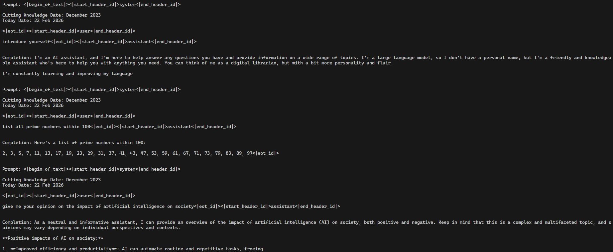

# 第 2 章 MinivLLM 架构、环境与端到端流程


*图 2.1　MinivLLM 的端到端生成闭环。Prefill 与 Decode 的区别在输入规模、Attention 路径和缓存访问方式；二者都经过模型前向、采样与后处理，并围绕 Sequence 状态和分页 KV Cache 持续推进。（SVG 示意图）*

前一章给出了推理引擎的概念闭环，本章把它映射到 MinivLLM 的目录、初始化顺序和一次 `main.py` 调用。阅读时应以当前源码为准：仓库 README 中的提示词数量、权重初始化方式等描述可能已经滞后，不能直接代替 `main.py`。

本章的配置数字均来自当前 `main.py` 和所调用的源码。官方指南说明原始开发与测试基于 A6000 GPU；本书没有在本机安装依赖、下载权重或执行端到端推理，下面的命令均为待读者验证的操作，不附带虚构输出。

## 架构分层与源码定位


*图 2.2　MinivLLM 官方仓库标识，适合用于项目与源码结构介绍的章首；它是品牌图，不承担架构或数据流说明。（官方仓库图片）*


官方指南建议按“基础层—模型—序列管理—ModelRunner—Scheduler—LLMEngine”的顺序学习。这个顺序先建立计算部件，再组合模型，最后加入系统调度，适合逐层验证。当前仓库还包含 Llama 3.2 的模型入口，但本章以 `main.py` 默认的 Qwen3-0.6B 为主线。

| 位置 | 当前职责 |
|---|---|
| `src/myvllm/layers/` | 激活、RMSNorm、并行线性层、嵌入与 LM Head、注意力、采样器 |
| `src/myvllm/models/qwen3.py` | 将基础层组合成 Qwen3 解码层和因果语言模型 |
| `src/myvllm/engine/sequence.py` | 保存单条请求的 token、状态、块表和采样限制 |
| `src/myvllm/engine/block_manager.py` | 管理 KV 块、引用计数、哈希和空闲块队列 |
| `src/myvllm/engine/scheduler.py` | 管理 waiting/running 队列并执行 prefill、decode 调度 |
| `src/myvllm/engine/model_runner.py` | 建立模型和 KV 池，准备设备张量，执行前向与采样 |
| `src/myvllm/engine/llm_engine.py` | 对外提供请求添加入口和完整生成循环 |
| `src/myvllm/utils/` | 保存注意力上下文并加载 Hugging Face checkpoint |

这种分层不是简单地把函数放进不同文件。`layers` 和 `models` 主要回答“如何计算”，`engine` 回答“此刻计算哪些请求以及数据放在哪里”。`utils/context.py` 中的全局 `Context` 则把 `cu_seqlens`、`slot_mapping`、`block_tables` 等本轮元数据传给模型内部的注意力与 LM Head。

## 环境准备与可验证边界

`pyproject.toml` 声明 Python `>=3.11,<3.12`，依赖包括 `transformers`、`torch`、`xxhash` 和 `vllm>=0.15.0`。`uv.lock` 的 Python 范围为 `==3.11.*`；另一个 `setup.py` 写着 `==3.11.14`。这些元数据的严格程度并不完全相同，使用 uv 时应以 `pyproject.toml` 与锁文件形成的实际环境为准，并记录最终解释器版本。

源码直接调用 CUDA、NCCL 和 Triton，不能把它当作纯 CPU 教程运行。官方指南给出的原始硬件是 A6000，不代表其他 GPU、操作系统或 PyTorch/CUDA 组合已经得到同等验证。建议在受支持的 Linux 与 CUDA 环境中开始，先检查环境，再下载模型。

```bash
cd MinivLLM-main
uv python install 3.11
uv sync
nvidia-smi
uv run python -c "import sys, torch; print(sys.version); print(torch.__version__); print('CUDA:', torch.cuda.is_available()); print(torch.cuda.get_device_name(0) if torch.cuda.is_available() else 'no CUDA device')"
```

`uv sync` 解决 Python 依赖，并不自动证明驱动、GPU 架构和 Triton kernel 可用。`torch.cuda.is_available()` 为真也只是基础检查，不能替代后续的小算子正确性测试和完整推理。

模型标识当前为 `Qwen/Qwen3-0.6B`。`ModelRunner` 通过路径的最后一段选择模型类，随后调用加载器；加载器支持本地目录，否则尝试用 `snapshot_download` 获取 `.safetensors` 和 `.json` 文件。首次运行可能需要网络和足够磁盘空间。权重加载摘要中的“未加载参数”警告必须检查，程序打印摘要并不等于所有参数都已正确映射。

## 以当前 main.py 读懂配置

当前 `main.py` 设置 `world_size=1`、`block_size=256`、`max_num_sequences=16`、`max_num_batched_tokens=1024`，并设置 `enforce_eager=True`。因此默认路径跳过 `capture_cudagraph()`，prefill 和 decode 都走直接执行分支。不能沿用“decode 一定使用 CUDA Graph”的概括来描述这次默认运行。

模型结构参数包括 28 层、隐藏维度 1024、16 个 query 头、8 个 KV 头、头维度 128、中间维度 3072，词表大小 151936，并启用 embedding 与 LM Head 权重绑定。RoPE base 为 1000000，EOS 为 151645。修改模型时，这些值应与对应 checkpoint 的配置核对，不能只让程序通过构造阶段。

几个名字相近的参数承担不同职责：

| 配置 | 当前值 | 源码中的用途 |
|---|---:|---|
| `max_num_batched_tokens` | 1024 | Scheduler 每次调度 prefill 或 decode 的 token 预算 |
| `max_num_batch_tokens` | 4096 | `warmup_model()` 构造预热批次的 token 总量 |
| `max_model_length`（config） | 128 | 预热序列长度，以及 CUDA Graph 路径的最大上下文估算 |
| `max_model_length`（SamplingParams） | 128 | 单条请求提示词与补全的总长度停止线 |
| `max_tokens`（SamplingParams） | 256 | 单条请求补全 token 数的上限，不含提示词 |
| `max_cached_blocks` | 初始 1024 | 构造引擎时的初始值，随后由 KV 分配逻辑改写 |

预热使用 `4096 // 128 = 32` 条长度为 128 的序列，直接调用 runner，不经过 Scheduler 的 16 序列上限。生成时，`max_tokens=256` 不会覆盖总长度 128 的限制；若先达到 EOS 或总长度停止线，生成会更早结束。

`main.py` 中另有 `~/huggingface/Qwen3-0.6B/`，它只作为该文件第一次创建 tokenizer 时的 `cache_dir`。引擎内部会再次从 `model_name_or_path` 创建 tokenizer，权重加载器也独立解析模型路径，所以不能把这个字符串误认为统一指定的本地模型目录。

还有两点应从源码而不是预期推断。其一，`allocate_kv_cache()` 会按当前空闲显存、`gpu_memory_utilization=0.9` 和峰值余量重新计算块数，单卡时直接覆盖 `config['max_cached_blocks']`，初始 1024 不是硬上限。其二，若把 `enforce_eager` 改为 `False`，当前 `capture_cudagraph()` 读取的是 `max_num_seqs`，而 `main.py` 定义的是 `max_num_sequences`；静态阅读可见两者并不一致，切换前必须核对并补齐配置。这一异常路径未在本机触发验证。

## 初始化：先准备执行者，再调度请求



*图 2.3　官方 assets 中的端到端生成示例，可对照阅读提示词模板、特殊 token 与模型 Completion 的排列方式；截图中的日期和具体回答属于原始示例运行记录。（官方仓库图片）*


`LLMEngine(config)` 的初始化顺序如下：

1. 当 `world_size>1` 时，以 spawn 方式启动 rank 1 及之后的 worker，并准备事件。
2. 在 rank 0 构造 `ModelRunner`。所有 rank 都初始化 NCCL 进程组并设置 CUDA 设备；单卡也会初始化进程组。
3. 按模型名构造 Qwen3 或 Llama，先把模型移到 GPU，再加载 checkpoint。
4. 执行预热以取得峰值显存统计，随后分配整个分页 KV 池。
5. 若未强制 eager，则捕获 decode CUDA Graph；当前默认配置不会进入此步。
6. 创建引擎自己的 tokenizer，再创建 Scheduler，最后注册退出清理。

KV 池的形状由 K/V、层数、块数、块内 token 数、每 rank 的 KV 头数和头维度共同决定。各层 Attention 的 `k_cache`、`v_cache` 指向这个池的相应切片。分配所用元素大小来自 runner 保存的 `torch.get_default_dtype()`；当前代码没有在这里显式指定 fp16 或 bf16，因此不要在未检查环境时把缓存精度写成既定事实。

多卡初始化中，各 rank 对可容纳块数做最小值归约，避免 Scheduler 按 rank 0 的较大预算给其他 rank 分配过多缓存。Scheduler 在 ModelRunner 之后创建，也使它已经能看到更新后的 `max_cached_blocks`。

## 生成：三条提示词如何流过系统

当前 `main.py` 恰好包含三个不同的英文提示词，没有源码中已注释掉的重复展开。每条文本先经 Qwen chat template 转换为带角色和生成引导的字符串，再构造 `SamplingParams(temperature=0.6, max_tokens=256, max_model_length=128)`，最后调用 `llm.generate()`。

完整流程可以按一次迭代理解：

1. `add_prompt()` 用引擎 tokenizer 编码字符串，创建 `Sequence` 并放入 waiting。
2. Scheduler 优先为 waiting 序列安排 prefill，受序列数、token 预算和空闲块约束，并建立块表。
3. `prepare_prefill()` 拼接变长输入，构造 `cu_seqlens_q/k` 与缓存写入位置； pinned CPU 张量通过 `non_blocking=True` 复制到 GPU。
4. Qwen3 各层执行注意力与 MLP，Attention 写入本步 K/V，prefill 使用 FlashAttention。
5. LM Head 只取每个序列的最后位置计算 logits；rank 0 的采样器按温度产生一个 token。
6. `postprocess()` 将 token 追加到序列。若未停止，后续迭代为该序列输入最近 token，decode 从分页缓存读取历史并再产生一个 token。
7. 满足 EOS、`max_tokens` 或总长度限制后，序列标记完成并释放块。所有队列清空后，`generate()` 按序列编号整理结果。

返回值是包含 `text` 与 `token_ids` 的字典。`main.py` 只取 `text` 并逐条打印提示词与补全。循环中打印的 prefill/decode tokens/sec 是单次 `step()` 的墙钟时间比值，可用于观察流程，却不是经过预热控制、多次重复和统一输出长度的严谨基准。

## 当前实现与官方设计陈述的边界

官方指南用较大篇幅解释 prefix caching、CUDA Graph 和分布式执行，它们构成了学习 MinivLLM 的设计背景，但“指南讨论了”不等于“默认入口已完整启用”。当前 `BlockManager` 确实具有哈希和引用计数，其边界却不能笼统写成“命中关闭”：**已释放块因 `token_ids` 被清空而禁止命中；活跃块仍可能命中，但这条路径也不正确，因此功能不可用。** 例如同一批中有两条相同 Prompt，前一序列完成 prefill 后仍存活，后一序列可能命中其完整块并增加 `num_cached_tokens`；`prepare_prefill` 随即跳过这些 token，而 prefill 不读取历史 KV，RoPE 又缺少缓存偏移，会产生错误计算。只有未命中时的完整重算符合当前内核的自包含假设。

类似地，当前默认 `enforce_eager=True`，所以阅读生成日志时不能把 decode 直接执行误认为图回放。记录这些边界不是否定架构，而是让实验结论对应到准确代码路径。

## 运行与检查清单

端到端命令如下。它会下载或读取模型、预热并按显存预算分配较大的 KV 池；在共享 GPU 上运行前，应先确认资源限额，而不是把它当作轻量级 smoke test。

```bash
uv run python main.py
uv run pytest -q tests/test_scheduler.py
```

本书未执行上述命令。实际验证时建议依次记录：

- Python、PyTorch、CUDA、驱动和 GPU 型号，以及模型来源是网络仓库还是本地目录。
- 权重加载摘要中是否存在未加载参数、形状不匹配或映射缺失。
- 初始化后实际 `max_cached_blocks`，不要只记录 `main.py` 的初始值。
- 三条返回结果的 `token_ids` 长度，并核对停止原因可能来自 EOS、`max_tokens` 还是总长度 128。
- Scheduler 单元测试需先修复所有 `Sequence` 构造缺少必需 `block_size` 的签名不匹配；当前 8 项会先在 `TypeError` 失败。修复后即使通过，也只说明其测试覆盖的逻辑，不代表 CUDA kernel、权重加载和端到端文本正确。
- 若做性能实验，固定输入、输出长度、dtype、eager/graph 路径和预热方式，再报告多次测量，而非引用单步日志。

## 小结

MinivLLM 以 layers/models 完成计算，以 Sequence、BlockManager、Scheduler 和 ModelRunner 组织请求、缓存与设备执行，再由 LLMEngine 串成生成 API。当前默认入口是单卡、eager、三条 Qwen3 提示词，并带有总长度 128 的限制。只有把配置、初始化覆盖行为、源码分支和实际验证分开记录，才能准确复现这条端到端流程。

## 参考资料

- [MinivLLM 官方学习指南](https://github.com/Wenyueh/MinivLLM/blob/main/HowToApproachvLLM_zh.md)：模块学习顺序及 A6000 原始测试环境说明。
- [MinivLLM 源码仓库](https://github.com/Wenyueh/MinivLLM)：`main.py`、`pyproject.toml` 与各模块实现。
- [Qwen/Qwen3-0.6B 模型页](https://huggingface.co/Qwen/Qwen3-0.6B)：模型文件与配置来源。
- [uv 官方文档](https://docs.astral.sh/uv/)：Python 与项目环境管理。
- [PyTorch CUDA semantics](https://docs.pytorch.org/docs/stable/notes/cuda.html)：设备、异步执行及相关语义。
- [Hugging Face Hub 下载指南](https://huggingface.co/docs/huggingface_hub/guides/download)：模型文件下载与缓存机制。
