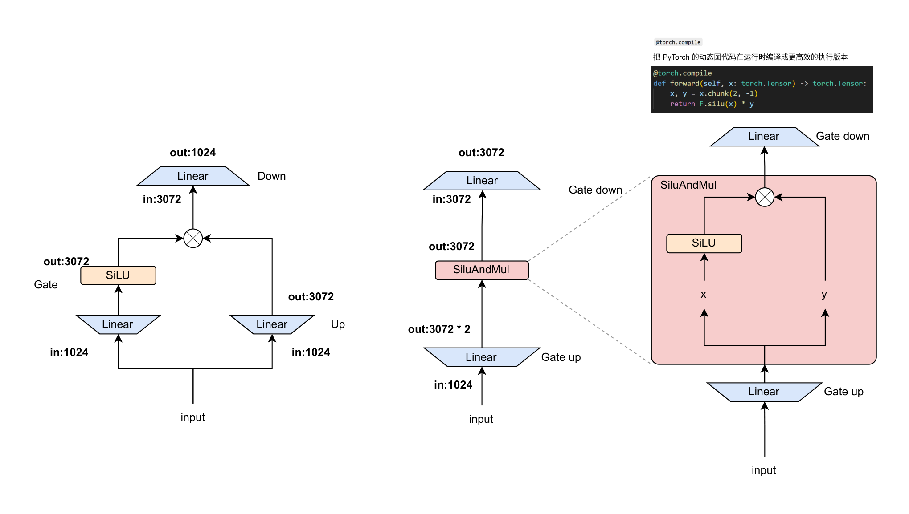
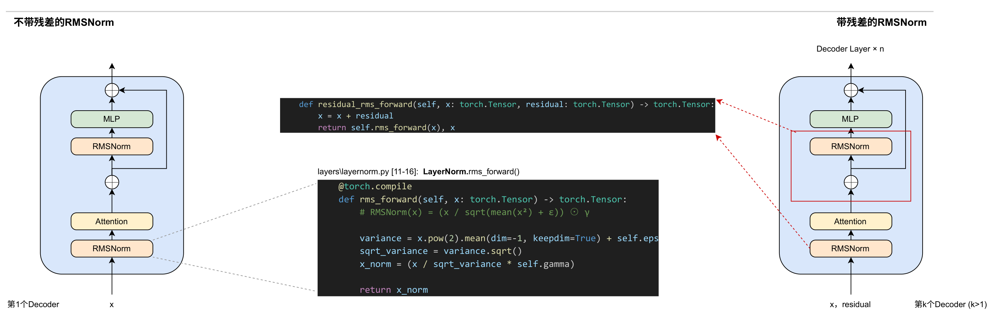

# 第 3 章 激活函数与 RMSNorm

注意力与矩阵乘法决定信息如何混合，激活函数和归一化则决定这种混合以什么数值形式继续传播。在 Qwen3 的 MLP 中，SiLU 与逐元素乘法组成门控分支；在解码层和注意力头内部，RMSNorm 调整激活尺度，并与残差连接共同组织数据流。

本章先解释数学含义，再逐行对应 MinivLLM 实现。官方指南给出了 A6000 上关于 `torch.compile` 的基准表和趋势总结；本章只把它们作为特定环境的实验报告，不视为普遍性能保证。所有验证代码均未在本机执行，文中不编造数值比较或运行时间。

## 源码定位



*图 3.1　从独立的 Gate、Up、Down 分支，到合并 Gate Up 权重，再到 SiluAndMul 的门控计算，这张图串起了 activation.py 的核心路径；同时标出了 1024 与 3072 之间的维度变化。（原课程课件）*


- `src/myvllm/layers/activation.py`：`SiluAndMul`，沿最后一维拆分输入，计算 `silu(x) * y`。
- `src/myvllm/layers/layernorm.py`：名为 `LayerNorm` 的模块，实际实现 RMSNorm，并提供带 residual 的调用形式。
- `src/myvllm/models/qwen3.py`：`Qwen3MLP`、`Qwen3Attention` 和 `Qwen3DecoderLayer` 中的具体连接方式。
- `src/myvllm/utils/loader.py`：将 checkpoint 的 `gate_proj` 与 `up_proj` 按输出维拼接为 `gate_up`。
- `main.py`：当前模型维度、`qkv_bias=False` 和 `rms_norm_epsilon=1e-6` 等配置。

类名 `LayerNorm` 容易让读者误以为它执行标准 LayerNorm。判断实际算法应看 `rms_forward()`，而不是只看类名；同样，配置字段已经传入模型构造函数，也不代表它最终一定传到了每个归一化模块，后文会单独核对这一点。

## 从 SiLU 到门控 MLP

SiLU 定义为

$$
\operatorname{SiLU}(x)=x\,\sigma(x),\qquad
\sigma(x)=\frac{1}{1+e^{-x}}.
$$

它不是把负数全部截断为零的 ReLU。输入为负时，sigmoid 提供平滑门控，输出仍可能是一个小的非零值；输入增大时，sigmoid 接近 1，SiLU 逐渐接近线性函数。

GELU 常写成 $x\Phi(x)$，其中 $\Phi$ 是标准正态分布的累积分布函数。官方指南把 SiLU、GELU 都列为激活函数学习示例，但当前 `activation.py` 只实现 `SiluAndMul`，不能据此声称仓库已经提供独立 GELU 层。

MinivLLM 的核心实现只有两行有效计算：

```python
@torch.compile
def forward(self, x: torch.Tensor) -> torch.Tensor:
    x, y = x.chunk(2, -1)
    return F.silu(x) * y
```

若输入最后一维为 $2I$，两个分块分别为 gate 和 up，输出最后一维就是 $I$：

$$
\operatorname{SiluAndMul}([g,u])=\operatorname{SiLU}(g)\odot u.
$$

这已经不是单独对隐藏状态逐点施加 SiLU，而是 SwiGLU 风格的门控计算。一个分支决定通过程度，另一个分支提供被调制的信息。最后一维必须能拆成形状匹配的两半；使用偶数 $2I$ 是最直接、也最符合模型配置的约束。

`Qwen3MLP` 先用 `MergedColumnParallelLinear` 一次得到 `[gate, up]`，再调用激活，最后经 `down_proj` 回到隐藏维度：

```python
def forward(self, x):
    return self.down_proj(self.activation(self.gate_up(x)))
```

设输入为 $h$，三层对应的数学形式是

$$
\operatorname{MLP}(h)=W_{down}\left(\operatorname{SiLU}(W_{gate}h)\odot W_{up}h\right).
$$

加载器按 `[gate_weight, up_weight]` 的顺序拼接权重，与 `chunk()` 后前半做 SiLU、后半参与乘法的顺序一致。若交换拼接顺序，张量形状仍可能正确，但函数已经改变；这也是仅用 shape 检查不足以证明权重映射正确的原因。

## RMSNorm 计算了什么

对最后一个维度大小为 $d$ 的向量 $x$，当前实现的 RMSNorm 为

$$
\operatorname{RMSNorm}(x)=
\frac{x}{\sqrt{\frac{1}{d}\sum_{j=1}^{d}x_j^2+\epsilon}}
\odot \gamma.
$$

源码与此逐项对应：

```python
variance = x.pow(2).mean(dim=-1, keepdim=True) + self.eps
sqrt_variance = variance.sqrt()
x_norm = x / sqrt_variance * self.weight
```

变量名虽然叫 `variance`，这里没有减去均值，因此严格说是“均方值加 epsilon”，不是统计学意义上的方差。`keepdim=True` 保留归一化维度，使分母可以沿最后一维广播到原输入。

标准 LayerNorm 通常先计算均值并做中心化，再除以标准差，并可带缩放与偏移。RMSNorm 省略均值中心化和偏置，仅按均方根缩放，再乘可学习参数 $\gamma$。官方指南将其概括为“不做均值中心化、只使用 RMS”，与当前计算一致；“更高效”则需要结合具体 kernel、形状和硬件测量，不能只由公式直接推出固定加速比。

`LayerNorm.__init__()` 对传入的 `gamma` 做 `detach().clone()`，再包装成 `nn.Parameter` 保存为 `weight`。这样参数可以被优化器识别，也能按 checkpoint 名称加载。只读的 `gamma` property 是兼容别名，并非第二份独立参数。

## 残差为何作为返回值一起传递



*图 3.2　第一个 Decoder 与后续 Decoder 的输入约定不同：后续层需要把残差相加后再做 RMSNorm，并保留新的残差。中间两段代码可用来对照 residual_rms_forward 与 rms_forward 的职责边界。（原课程课件）*


模块支持两种调用：

```python
def residual_rms_forward(self, x, residual):
    x = x + residual
    return self.rms_forward(x), x
```

第一个返回值是归一化后的分支输入，第二个返回值是**未归一化**的残差和。调用方若只保留第一个值，就会丢失后续残差连接需要的信息。这里的 residual 加法位于 `residual_rms_forward()` 内，而 `@torch.compile` 只装饰 `rms_forward()`，所以不能把当前实现描述为一个已证明完全融合的 residual+norm 单 kernel。

Qwen3 解码层采用 pre-norm 结构。第一层收到 `residual=None` 时，先保存输入为 residual，再对输入归一化；注意力输出与 residual 相加后，经 post-attention norm 得到 MLP 输入，同时保留未归一化的和。MLP 输出与这份 residual 的下一次相加发生在下一层开头：

```python
# 省略 positions 与注意力内部细节
if residual is None:
    residual = x
    x = self.input_layernorm(x)
else:
    x, residual = self.input_layernorm(x, residual)

x = self.self_attn(x, positions)
x, residual = self.post_attention_layernorm(x, residual)
x = self.mlp(x)
return x, residual
```

因此循环中始终存在两条逻辑数据流：`x` 是当前归一化分支，`residual` 是等待下一次相加的主干。最后一层之后，`Qwen3Model` 调用 `self.norm(x, residual)`，取归一化结果作为隐藏状态并丢弃最终 residual。理解这一约定，比在每一行机械寻找独立的 `x = x + residual` 更重要。

## Qwen3 中还有哪些 RMSNorm

除解码层入口、注意力后和最终归一化外，`Qwen3Attention` 还为 Q、K 分别建立 `q_norm` 与 `k_norm`。Q/K/V 投影拆分为每头张量后，归一化沿最后的 `head_dim` 维进行；V 不经过这两个模块。当前 `main.py` 的 `qkv_bias=False`，满足源码中的条件分支，因此 Q、K norm 会执行，随后才应用 RoPE 和注意力。

epsilon 的传递则需要特别谨慎。`main.py` 配置了 `rms_norm_epsilon=1e-6`，`ModelRunner` 也把它传入 Qwen3 构造函数；但当前 `Qwen3Attention`、`Qwen3DecoderLayer` 和 `Qwen3Model` 创建这些 `LayerNorm` 时都没有传入 `eps`。根据 `LayerNorm` 的签名，它们实际采用默认值 `1e-5`。

这是静态源码事实，不是运行猜测。检查模型时可以使用下面的只读打印，而不要只看配置字典：

```python
print(model.model.layers[0].input_layernorm.eps)
print(model.model.layers[0].self_attn.q_norm.eps)
print(model.model.norm.eps)
```

这个例子也说明，复现模型不能只核对字段名称和参数 shape。归一化位置、epsilon、残差返回约定与权重拼接顺序，都会影响与参考实现的一致性。

## 正确性检查先于性能测试

下面的脚本用小张量检查激活和 residual RMSNorm。参考式刻意保持与源码相同的 float32 运算顺序，避免把 dtype 转换引入首轮测试。命令应从仓库根目录运行；即使不调用 CUDA，`torch.compile` 仍可能要求可用的编译工具链。

```bash
uv run python - <<'PY'
import torch
import torch.nn.functional as F
from myvllm.layers.activation import SiluAndMul
from myvllm.layers.layernorm import LayerNorm

torch.manual_seed(0)
x = torch.randn(4, 6, 8, dtype=torch.float32)
gate, up = x.chunk(2, -1)
actual = SiluAndMul()(x)
torch.testing.assert_close(actual, F.silu(gate) * up)

gamma = torch.linspace(0.5, 1.5, 8)
residual = torch.randn_like(x)
layer = LayerNorm(gamma, eps=1e-6)
normed, new_residual = layer(x, residual)
expected_residual = x + residual
expected = expected_residual / (
    expected_residual.pow(2).mean(dim=-1, keepdim=True) + 1e-6
).sqrt() * gamma
torch.testing.assert_close(new_residual, expected_residual)
torch.testing.assert_close(normed, expected)
print("activation and RMSNorm checks passed")
PY
```

这段代码是建议的验证方案，本书没有保存它的预期运行输出。若断言失败，应先记录 shape、dtype、epsilon 和最大绝对误差，再判断是实现差异、容差问题还是编译路径差异；不要为了通过测试而直接放宽容差。

还可补充零输入、非单位 gamma、二维与三维输入、跨 block 的残差形状等测试。对激活层，应单独检查输出最后一维是否减半；对 RMSNorm，应验证返回的 residual 是相加结果而非归一化结果。

## 怎样复核 torch.compile 性能陈述

`SiluAndMul.forward()` 和 `LayerNorm.rms_forward()` 都带有 `@torch.compile`。官方指南的测试采用 10 次预热、100 次计时，并在每次计时前后调用 `torch.cuda.synchronize()`。其报告趋势是：大张量更可能从编译中获益，小张量可能因额外开销而更慢。这些数字属于官方所述 A6000 环境，本书未复现，也不能推广为“编译后总是更快”。

自行实验时至少应控制以下变量：

1. 先验证编译与未编译路径的数值一致性，再开始计时。
2. 固定输入形状、dtype、设备和编译后端，将首次编译与稳态执行分开记录。
3. 预热后多次测量，使用 CUDA 同步或 CUDA Event 覆盖异步 GPU 工作，并报告分布而非只报最佳值。
4. residual 与无 residual 分开测，不能用包含额外加法和输出的一组结果对比另一组纯 RMSNorm。
5. 从较小张量开始。当前两个源码文件的 `__main__` 示例都创建 `(8, 4000, 8000)` 张量，激活示例还直接调用 `.cuda()`，不适合作为资源未知环境中的第一次检查。
6. 保存 PyTorch、CUDA、GPU、驱动和编译器版本；官方表格只能说明对应配置，不能替代本机数据。

## 小结

`SiluAndMul` 将 SiLU 门控与 up 分支相乘，是 Qwen3 MLP 的核心非线性；RMSNorm 不做均值中心化，而以均方根和可学习缩放调整最后一维。MinivLLM 还用成对返回值传递归一化分支与未归一化残差，并在 Q、K 上应用独立的 RMSNorm。当前 epsilon 配置未继续传入各 LayerNorm 实例，实际默认值为 `1e-5`。读通这些细节后，再以数值断言和小规模计时验证 `torch.compile`，才能同时保证正确性与实验结论的边界清楚。

## 参考资料

- [MinivLLM 官方学习指南：激活函数与 RMS LayerNorm](https://github.com/Wenyueh/MinivLLM/blob/main/HowToApproachvLLM_zh.md)：实现入口、官方基准方法及 A6000 结果。
- [MinivLLM 源码仓库](https://github.com/Wenyueh/MinivLLM)：`activation.py`、`layernorm.py`、`qwen3.py` 与权重加载实现。
- Zhang and Sennrich, [Root Mean Square Layer Normalization](https://arxiv.org/abs/1910.07467), 2019。
- Elfwing et al., [Sigmoid-Weighted Linear Units for Neural Network Function Approximation in Reinforcement Learning](https://arxiv.org/abs/1702.03118), 2018。
- Shazeer, [GLU Variants Improve Transformer](https://arxiv.org/abs/2002.05202), 2020。
- PyTorch 文档：[SiLU](https://docs.pytorch.org/docs/stable/generated/torch.nn.SiLU.html) 与 [torch.compile](https://docs.pytorch.org/docs/stable/generated/torch.compile.html)。
