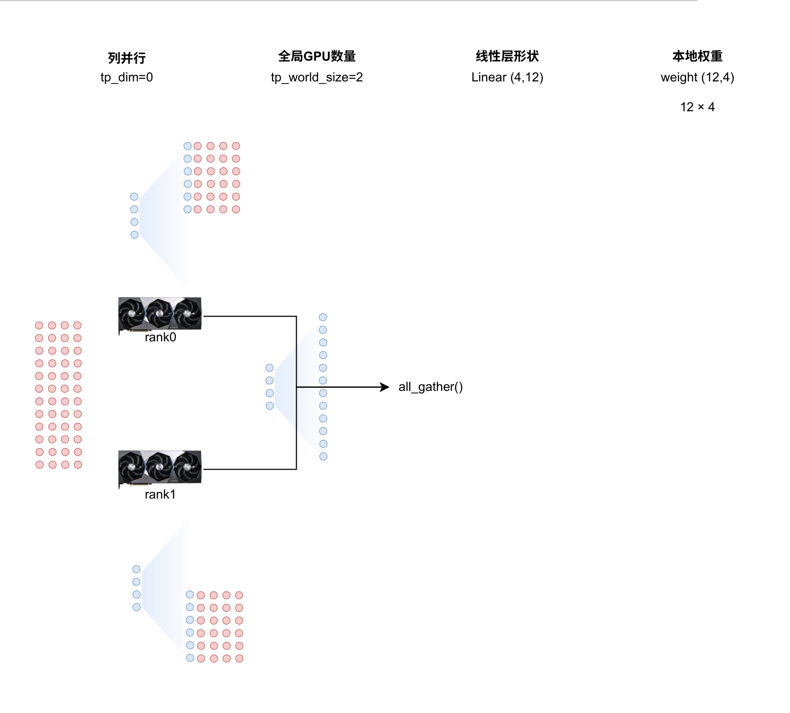
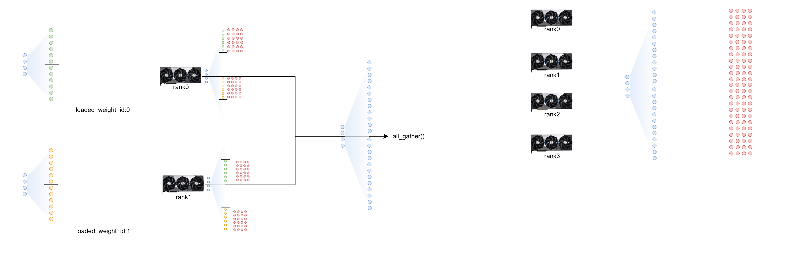
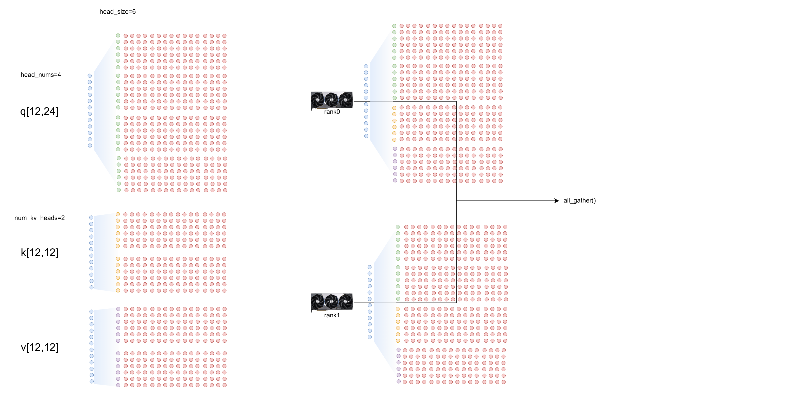
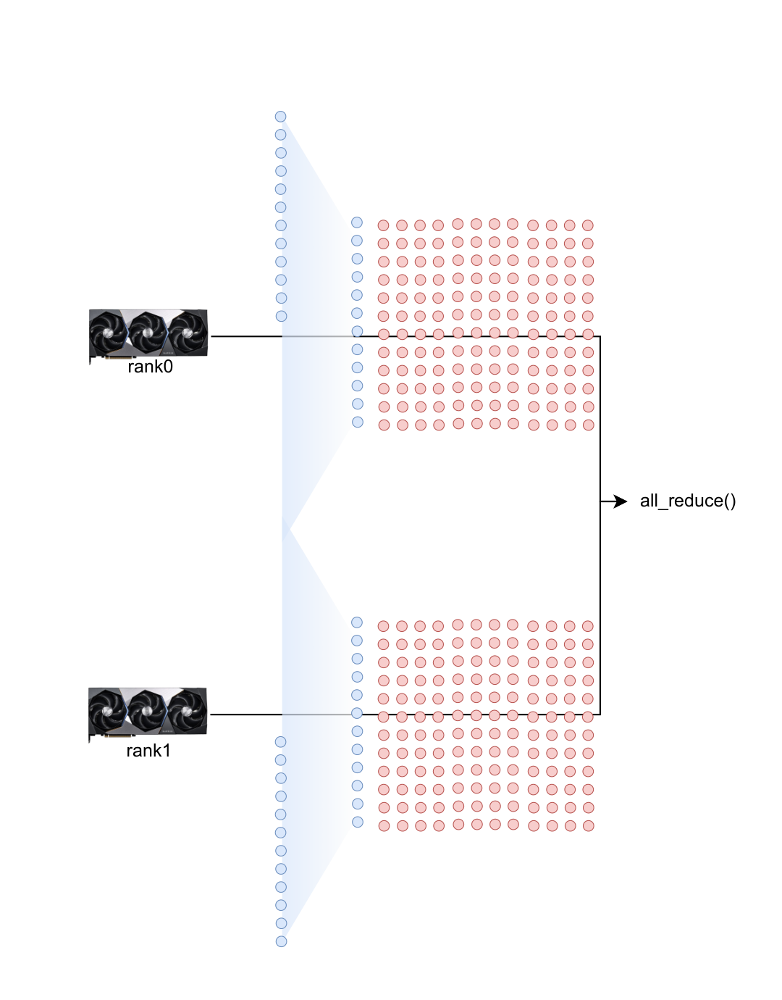

# 第 4 章 并行线性层与权重加载

![两个 rank 的张量并行对照图，统一使用 PyTorch 权重 W[out,in] 和 Y=XW 转置的记法。上半部分 ColumnParallelLinear 沿权重第 0 维切分输出特征，rank 0 与 rank 1 各持有一组完整输入维度的权重行，使用同一完整 X 计算不同的局部输出 Y0、Y1；本层前向不通信，若需完整输出才额外 AllGather 并拼接。下半部分 RowParallelLinear 沿第 1 维切分输入特征，各 rank 使用对应的 X0、X1 和局部权重计算部分和 P0、P1，再经 AllReduce SUM 得到所有 rank 相同的完整 Y。底部给出 QKV 或 gate_up 接局部分片激活，再接 o_proj 或 down_proj 与 AllReduce 的组合。](../resources/diagrams/tensor-parallel.svg)

*图 4.1　ColumnParallel 与 RowParallel 的分片方向和通信位置。这里的“列”按 Y=XWᵀ 的输出列理解，因此在 PyTorch 的 W[out,in] 上切第 0 维；RowParallel 切输入维度，并用 AllReduce 合并各 rank 的部分和。（SVG 示意图）*

线性层既是大语言模型中最主要的矩阵计算之一，也是张量并行切分的基本单元。MinivLLM 将“如何计算局部结果”和“如何从完整 checkpoint 取出局部权重”放在同一组类中。理解这两条路径，才能同时判断模型能否并行运行，以及并行运行后是否仍然等价于单卡模型。

## 源码定位



*图 4.2　列并行切的是输出特征：每个 rank 只保存一部分权重行并计算局部输出，再用 all_gather 恢复完整输出维。图中 Linear(4,12) 与 weight(12,4) 的方向也可用来核对 PyTorch 线性层权重形状。（原课程课件）*


本章对应以下实现：

- `src/myvllm/layers/linear.py`：`LinearBase`、`ReplicatedLinear` 与四类并行线性层；
- `src/myvllm/models/qwen3.py`、`src/myvllm/models/llama.py`：QKV、门控 MLP 和输出投影的组合方式；
- `src/myvllm/utils/loader.py`：实际 checkpoint 加载流程；
- `src/myvllm/engine/model_runner.py`：模型移动到 GPU 后调用加载器的顺序。

## 从矩阵方向理解切分

PyTorch 的线性层定义为

\[
y=xW^\mathsf{T}+b,
\]

其中输入最后一维大小为 \(I\)，`weight` 的形状是 `[O, I]`，而不是 `[I, O]`。因此，“按输出列切分”对应切 `weight` 的第 0 维，“按输入行切分”对应切第 1 维。先确认这一约定，后面的 `narrow(0, ...)` 与 `narrow(1, ...)` 就不会混淆。

`LinearBase` 从默认分布式进程组读取 `tp_rank` 和 `tp_size`，按已经切好的形状创建 `nn.Parameter`，并把绑定后的 `weight_loader` 方法挂到参数对象上。构造这些层之前必须初始化进程组；即使只有一张卡，代码也会调用 `dist.get_rank()`。这里的 `tp_dim` 主要记录切分语义，真正的切片逻辑仍在各子类中。

`ReplicatedLinear` 是未切分的参照实现：每个 rank 保存完整权重，前向直接执行 `F.linear`。它既可用于单卡模型，也适合作为并行正确性测试的基准。

## ColumnParallelLinear：切输出特征



*图 4.3　合并线性层不是把不同权重简单混成一片，而是先按 loaded_weight_id 计算逻辑偏移，再按 rank 取每段权重的本地切片。读图时可沿左侧两次加载追踪到中间的本地参数，再观察右侧的输出汇聚。（原课程课件）*


设张量并行度为 \(P\)，rank 为 \(r\)，且 \(O\) 能被 \(P\) 整除。第 \(r\) 个分片为

\[
W_r=W[rO/P:(r+1)O/P,\ :],\qquad y_r=xW_r^\mathsf{T}+b_r.
\]

每个 rank 都接收完整输入，只计算 \(O/P\) 个输出特征。其局部权重形状为 `[O / P, I]`，局部输出最后一维为 `O / P`。

该类的前向没有集合通信。这是“前向无通信”，并不表示任何使用场景都不需要通信：如果后续算子必须看到完整输出，就要像 `linear.py` 的自测那样执行 `all_gather`，再沿最后一维拼接。如果后续正好是能接收分片输入的 RowParallelLinear，则不必为了拼接而通信。

偏置也沿输出维切分，所以普通 ColumnParallelLinear 可以让同一个加载方法分别处理二维权重和一维偏置。

## RowParallelLinear：切输入特征并求和

RowParallelLinear 保存 `W` 的输入维度分片：

\[
W_r=W[:,\ rI/P:(r+1)I/P],\qquad
y=\sum_{r=0}^{P-1}x_rW_r^\mathsf{T}+b.
\]

这里 \(x_r\) 是输入最后一维的对应片段。每个 rank 先得到形状为 `[..., O]` 的部分和，随后 `forward` 在 `tp_size > 1` 时执行：

```python
dist.all_reduce(result, op=dist.ReduceOp.SUM)
```

通信后，每个 rank 都持有完整的求和结果。它与 ColumnParallelLinear 的差异不是简单的“切维方向不同”，还包括输入是否分片、输出是否完整，以及前向是否必须同步。

偏置需要单独核对。当前实现是在 `all_reduce` **之前**把局部 `self.bias` 加入 `result`。若每个 rank 都加载完整偏置 \(b\)，求和后会多算出 \((P-1)b\)。类内自测采用 `b_full / tp_size`，使各分片偏置之和恰为 \(b\)；另一种常见设计是先对无偏置部分求和，再只加一次完整偏置。阅读或扩展代码时，不能把这两种约定混用。此外，基类也给 bias 挂上了同一个 `weight_loader`，而 Row 的加载器读取第 1 维，不能直接用它加载一维偏置；自测因此单独复制缩放后的偏置。

## MergedColumnParallelLinear：先分片，再按模块排列

Qwen3 和 Llama 的 MLP 都有 `gate_proj` 与 `up_proj`。MergedColumnParallelLinear 将它们合并为一次矩阵乘，但 checkpoint 中仍是两个独立张量，因此加载器额外接收 `loaded_weight_id`。

假设各模块输出大小为 \(O_j\)，第 \(r\) 个局部参数的布局是

```text
[W_0 的 rank-r 分片 | W_1 的 rank-r 分片 | ...]
```

加载器用 `sum(output_sizes[:id]) // tp_size` 找局部写入偏移，再用 `output_sizes[id] // tp_size` 确定分片大小，同时从完整权重的第 0 维取本 rank 区间。也就是说，`param_data` 和 `loaded_weights` 都要切片：只切一边会造成模块错位或形状不符。

这种局部排列正好配合 `SiluAndMul`：局部输出的两个半区分别是本 rank 的 gate 与 up，逐元素计算后得到本 rank 的中间特征，再交给 RowParallelLinear 的 `down_proj`。整条 MLP 路径无需先恢复完整 gate/up。

构造函数只直接检查输出总和能否整除 `tp_size`，而分块加载实际还要求每个 `output_sizes[j]` 都能整除 `tp_size`。实践时应把后者作为明确前置条件。

## QKVColumnParallelLinear：按完整注意力头分片



*图 4.4　QKVColumnParallelLinear 需要分别维护 Q、K、V 的偏移和分片大小，尤其适合观察 GQA 中 Q 头数与 KV 头数不相等时的切分方式。每种颜色对应一类投影及其头片段。（原课程课件）*


QKV 投影不能只顾总输出维度，还必须保留注意力头边界。设 Query 头数为 \(H\)，KV 头数为 \(H_{kv}\)，头维为 \(d\)，则局部输出布局为

```text
[Q 的本地头 | K 的本地 KV 头 | V 的本地 KV 头]
```

局部大小为

\[
d\left(\frac{H}{P}+2\frac{H_{kv}}{P}\right).
\]

加载器用字符串 `"q"`、`"k"`、`"v"` 确定局部写入区间，再分别从三个完整投影矩阵中取第 0 维分片。每个头内部的 \(d\) 个维度不被拆散，因此本 rank 可以独立完成 reshape、RoPE 和注意力计算。GQA 中 \(H_{kv}<H\)，Q 与 K/V 的分片大小必须分别计算，不能假设三者等宽。

模型随后按本地的 `q_size` 和 `kv_size` 拆分 QKV，并将输出投影交给 RowParallelLinear。正常前向不需要收集完整 QKV；`linear.py` 自测中的 `all_gather` 和重新按 Q、K、V 拼接，只是为了与单卡参照比较。直接把各 rank 的 `[q_local | k_local | v_local]` 整体拼接，会得到错误的模块顺序。

## 四种层的前向契约

| 层类型 | 局部权重 | 前向输入 | 前向输出与通信 |
|---|---|---|---|
| ColumnParallelLinear | `[O/P, I]` | 完整输入 | 输出特征分片；无集合通信 |
| MergedColumnParallelLinear | `[sum(O_j)/P, I]` | 完整输入 | 各模块本地分片依次排列；无集合通信 |
| QKVColumnParallelLinear | `d(H/P+2H_kv/P)` 行 | 完整输入 | 完整头组成的 Q/K/V 本地分片；无集合通信 |
| RowParallelLinear | `[O, I/P]` | 输入特征分片 | `all_reduce(SUM)` 后为完整且各 rank 一致的结果 |

这里的通信结论只针对层自身的前向。权重加载、测试汇总以及外层模型可能另有通信。

## 权重加载：类内自测与实际加载器要分开阅读



*图 4.5　行并行沿输入维切分，因此单个 rank 的结果只是部分和，不能直接当作最终输出；all_reduce 的求和才把各分片贡献合并起来。它与列并行后的 all_gather 形成鲜明对照。（原课程课件）*


并行层提供的 `weight_loader` 体现了一种清晰协议：加载器遍历参数，发现参数带有自定义方法时，由该方法选择本 rank 分片；Merged 和 QKV 还要传入模块编号或名称。`linear.py` 的 `__main__` 测试正是手动调用这些方法，再检查并行结果与完整计算是否一致。

但当前 `ModelRunner` 实际调用的是 `utils/loader.py`。该加载器会先把 Hugging Face 的 Q、K、V 以及 gate、up 分别拼接，然后对合并参数直接执行 `param.data.copy_(qkv_weight)` 或 `copy_(gate_up_weight)`；普通参数也主要采用直接复制。它没有调用上述自定义 `weight_loader`，也没有使用模型中声明的 `packed_module_mapping` 来完成分派。

普通参数的通用 shape mismatch 回退并不一定失败或跳过。只要参数和 checkpoint 权重都非零维，代码就按第 0 维计算 `min_size`，执行 `param.data[:min_size].copy_(hf_weight[:min_size])`，随后把 `hf_name` 加入 `loaded_params`。若切片后的其余维度兼容，这会静默形成截断或部分复制，目标参数未覆盖的区域保留原值；它既不是按 `tp_rank` 选择分片，也不证明其余维度具有正确语义。复制真正抛出异常时，外层 `except` 才会把该项记入 `skipped_params`。

因此，单卡时完整拼接权重与参数形状一致，这条路径可以工作；多卡时局部参数小于完整权重，直接复制或上述回退都不能替代分片加载。部分不匹配项会进入跳过列表，另一些却可能被计入“成功加载”。由于 `loaded_params` 同时用于成功计数和未加载参数检查，加载摘要可能误报完整性，不能把“未列出 unloaded”或“Successfully loaded”当作数值正确的证据。阅读本章时，也不应把类内测试通过推断为“当前生产加载路径已经支持多卡”。要让二者一致，需要由实际加载流程按参数语义调用分片加载器，显式处理合并权重及偏置，并拒绝不符合预期的静默截断。

## 关键设计

1. **分片布局就是层间接口。** Column 的输出顺序必须与 Row 的输入顺序一致，不能只看元素总数。
2. **合并是为了计算与加载协同。** Merged/QKV 减少矩阵乘调度的同时，引入了模块内偏移和加载标识。
3. **集合通信由数据依赖决定。** 独立输出特征无需归约；输入被拆开的点积必须求和。
4. **整除条件属于正确性条件。** 输出维、中间维、Query 头数和 KV 头数都要与并行度匹配。
5. **参数对象上的加载器不是全局魔法。** 只有实际加载代码调用它，分片协议才会生效。

## 实践检查

1. 用两个小矩阵手算二路 Column 与 Row 分片，确认存储权重分别切第 0 维和第 1 维；检查 Row 的偏置只贡献一次。
2. 在仓库根目录运行 `uv run torchrun --nproc_per_node=2 src/myvllm/layers/linear.py`，按自己的 CPU/GPU 环境选择进程数。逐项核对测试中的单卡参照、分片加载和结果恢复，不预设误差数值。
3. 对 Merged 与 QKV 分别打印每个 rank 的局部形状和写入区间。恢复完整输出时先分模块拼接，再与 `F.linear` 参照比较，避免用错误的整体拼接掩盖布局问题。
4. 构造一个极小 checkpoint，分别走“手动调用 `weight_loader`”和 `load_weights_from_checkpoint` 两条路径，记录 `loaded_params`、跳过原因及未加载参数。另设只有第 0 维不同的普通参数，检查通用回退是否截断复制却仍计入 `loaded_params`；不要只看摘要，要逐元素核对目标张量。多卡实验前，先修正并验证实际加载路径。
5. 用非对称的 Q/K/V 大小测试 GQA，确认 `q_size`、`kv_size` 都是每卡数值，且每个注意力头保持完整。

## 小结

ColumnParallelLinear 切输出并保留局部结果，RowParallelLinear 切输入并用 `all_reduce` 合并点积部分和；Merged 与 QKV 则在此基础上规定模块内布局。并行线性层的正确性同时取决于矩阵方向、局部形状、头边界、偏置约定和加载协议。尤其要区分 `linear.py` 自测所用的分片加载器与 `utils/loader.py` 当前的直接复制及 `min_size` 回退路径；后者可能截断复制却仍计入 `loaded_params`，摘要不能替代逐 rank 数值核验。只有实际入口完成正确的分片语义，多卡模型才可能等价于单卡模型。

## 参考资料

- MinivLLM：`src/myvllm/layers/linear.py`、`src/myvllm/utils/loader.py`。
- MinivLLM：`src/myvllm/models/qwen3.py`、`src/myvllm/models/llama.py`。
- MinivLLM：《HowToApproachvLLM_zh》“线性层（支持张量并行）”一节。
- [PyTorch 分布式通信文档](https://pytorch.org/docs/stable/distributed.html)。
- [Megatron-LM：高效训练大语言模型的模型并行方法](https://arxiv.org/abs/1909.08053)。
