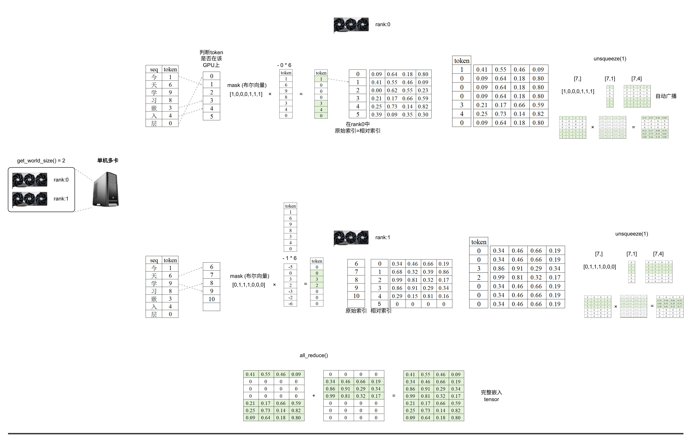
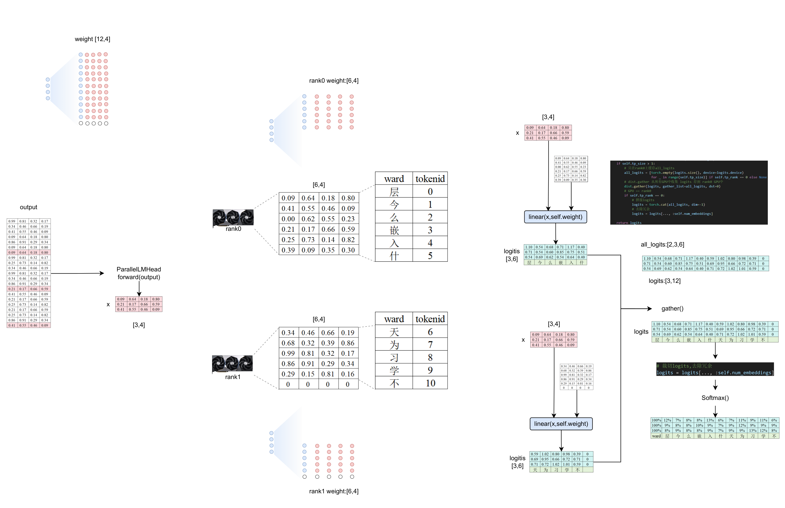

# 第 5 章 Vocab Embedding、LM Head 与采样

自回归模型的每一步可以概括为“token ID 变成隐藏状态，隐藏状态变成词表概率，再从概率中得到下一个 token ID”。MinivLLM 对这三个阶段分别使用 `VocabParallelEmbedding`、`ParallelLMHead` 和 `SamplerLayer`。三者形状上首尾相接，并行通信方式却并不相同。

## 源码定位



*图 5.1　词表并行嵌入的关键不是简单查表，而是“归属判断—本地索引—掩码置零—跨 rank 求和”这一串操作。图中 rank0 与 rank1 的 mask 互补，便于逐 token 验证计算过程。（原课程课件）*


本章对应以下实现：

- `src/myvllm/layers/embedding_head.py`：词表切分、嵌入归约、logits 收集与末 token 选择；
- `src/myvllm/layers/sampler.py`：温度缩放和随机采样；
- `src/myvllm/sampling_parameters.py`：采样与生成长度参数；
- `src/myvllm/models/qwen3.py`、`src/myvllm/models/llama.py`：嵌入和 LM Head 的组装及权重绑定；
- `src/myvllm/engine/model_runner.py`：prefill/decode 中的 logits 计算和 rank 0 采样。

## 为什么按词表切分

嵌入矩阵 \(E\) 的形状为 `[V, H]`，其中 \(V\) 是词表大小，\(H\) 是隐藏维。给定 token ID \(t\)，嵌入查表就是取向量 \(E[t]\)。MinivLLM 按第 0 维切分词表，而不是切隐藏维，因此每个 rank 只保存一部分 token 的完整向量。

设并行度为 \(P\)。实现先把词表补齐到

\[
V_{pad}=\left\lceil\frac{V}{P}\right\rceil P,\qquad V_s=V_{pad}/P.
\]

本地权重形状为 `[V_s, H]`，rank \(r\) 负责逻辑区间 `[rV_s, (r+1)V_s)`。补齐最多增加 \(P-1\) 行，使各分片形状一致，便于并行计算和集合通信。

`weight_loader` 用原始词表大小裁剪实际区间：有效行从完整权重复制，超出 \(V\) 的本地行显式清零。最后一个 rank 可能同时包含有效行和补齐行；当词表很小而并行度较大时，某些 rank 甚至可能没有有效行。

## VocabParallelEmbedding 的一次前向

一个批次中的 token 可能落在任意 rank 的词表区间。实现先用三个条件构造本地掩码：ID 不小于本地下界、小于本地上界，并且小于原始词表大小。随后把全局 ID 换算成本地行号：

```python
mask = (x >= start) & (x < start + shard_size) & (x < vocab_size)
x = mask * (x - start)
output = F.embedding(x, self.weight)
output = mask.unsqueeze(1) * output
dist.all_reduce(output, op=dist.ReduceOp.SUM)
```

不属于本 rank 的 ID 经乘法后变成行号 0，因此第二次掩码不可省略：它把这些无效查表结果清零，而不是误把本地第 0 个 token 的向量留给其他序列。有效位置只在一个 rank 上保留非零向量，所以求和后恰好得到该 token 的完整嵌入。

`all_reduce(SUM)` 使所有 rank 都得到相同的 `[num_tokens, H]` 输出，后续 Transformer 层可以继续使用复制式隐藏状态。这也说明嵌入层虽然查表本身是局部操作，前向仍有一次密集向量通信。

第二次掩码只针对分布式分支执行。单卡时没有越界 rank，直接使用查表结果。调用方仍应保证 ID 位于 `[0, V)`；当前分布式掩码会把负数和超出原始词表的 ID 全部屏蔽，不能把这种静默结果当作输入校验机制。

## ParallelLMHead：复用分片，反向产生 logits

隐藏状态 \(h\) 经过 LM Head 得到词表 logits：

\[
z_v=hE[v]^\mathsf{T},\qquad z=hE^\mathsf{T}.
\]

`ParallelLMHead` 继承 `VocabParallelEmbedding`，所以本地权重仍是 `[V_s, H]`；但它不重写为查表，而是用 `F.linear(x, self.weight)` 计算本地词表分数。其输出最后一维是 `V_s`，各 rank 分别负责不同 token 的 logits，不能对这些分数求和。

当 `tp_size > 1` 时，实现调用 `dist.gather(..., dst=0)`：只有 rank 0 的 `gather_list` 接收所有分片，其他 rank 不得到完整 logits。rank 0 沿最后一维拼接为 `V_pad`，再裁掉末尾补齐项，恢复恰好 `V` 个分数。其他 rank 此时仍返回本地 logits，因此调用方必须遵守“只在 rank 0 采样”的约定。

裁剪不是可有可无的清理。补齐权重虽被置零，对应的 logits 也只是有限的零值，并非负无穷；若保留这些列，采样器仍可能选中不存在的 token ID。

嵌入与 LM Head 的通信可以对照记忆：前者对每个位置只有一个有效向量，用 `all_reduce` 求出完整隐藏状态；后者各位置包含不同词表分数，用 `gather` 在 rank 0 拼出完整词表。

## Prefill 只取每条序列的最后一个位置

因果语言模型生成下一个 token 时，只需要每条序列当前末端的隐藏状态。MinivLLM 的 prefill 将不同长度序列打包在一起，并用 `cu_seqlens_q` 记录累计边界。若边界为 `[0, 5, 8, 12]`，三条序列的末位置索引就是：

```python
last_token = context.cu_seqlens_q[1:] - 1  # [4, 7, 11]
x = x[last_token].contiguous()
```

这样 LM Head 只计算三条序列的 logits，而不必为所有 12 个输入位置计算完整词表矩阵。`.contiguous()` 把高级索引选出的结果整理为规则连续布局，避免后续通信对不连续视图产生额外要求。Decode 阶段每个序列本来就只有一个新位置，因此不再筛选。

## 权重绑定到底绑定了什么



*图 5.2　LM Head 复用词表分片，但输出的是 logits 而不是嵌入。每个 rank 先计算本地词表的 logits，再在 rank0 汇聚、拼接并去除词表补齐产生的冗余列，最后才能得到完整词表上的概率。（原课程课件）*


嵌入矩阵按行把 ID 映射为隐藏向量，LM Head 则用 \(hE^\mathsf{T}\) 把隐藏向量映射回词表。二者可以共享同一张 `[V, H]` 参数矩阵。模型构造函数中的实现是：

```python
if tie_word_embeddings:
    self.lm_head.weight = self.model.embed_tokens.weight
```

这里不是把数值复制一遍，而是让两个模块引用**同一个 `Parameter` 对象**。任一处更新参数，另一处立即看到相同内容；在训练语义中，它们也不会形成两份独立梯度参数。张量并行下，两侧在同一 rank 上共享相同的 `[V_s, H]` 本地分片。

Qwen3 包装类的 `tie_word_embeddings` 默认值为 `False`，此时嵌入和 LM Head 是两个独立参数；Llama 包装类默认值为 `True`。实际模型仍以传入的配置为准，不能只根据模型家族名称推断。权重绑定也不意味着所有 checkpoint 都省略 `lm_head.weight`，加载时应结合配置和 checkpoint 键检查。

可用 `model.lm_head.weight is model.model.embed_tokens.weight` 验证对象绑定；仅比较 `torch.equal` 只能说明当前数值相同，不能证明绑定。加载完成后还应复查这一关系，确认加载过程没有意外替换参数对象。

## 从 logits 到概率：温度的作用

`SamplerLayer` 首先按每条序列的温度缩放 logits，再沿词表维做 softmax：

\[
p_i(T)=\frac{\exp(z_i/T)}{\sum_j\exp(z_j/T)}.
\]

\(T<1\) 会拉大不同 token 的 logit 差距，使分布更尖锐；\(T>1\) 会缩小差距，使分布更平坦。温度不会改变模型已经算出的排序。

`ModelRunner.prepare_sample` 把每个序列的 `temperature` 组成 float32 张量并搬到 GPU，`temperature.unsqueeze(-1)` 使其能按 batch 行广播。采样器对 `logits` 使用原地除法，所以调试时若还要保留原始 logits，应在调用前另行保存。

`SamplingParams` 在初始化时要求 `temperature > 1e-10`，明确禁止把温度设为 0 来表示贪心解码。当前实现没有独立的 greedy 分支，也没有 top-k、top-p 或重复惩罚逻辑；不能把这些常见采样选项当作本仓库已有能力。

## 指数随机变量为何等价于类别采样

代码没有直接调用 `torch.multinomial`，而是执行：

```python
probs = torch.softmax(logits, dim=-1)
sample_tokens = probs.div_(
    torch.empty_like(probs).exponential_(1).clamp_min_(1e-10)
).argmax(dim=-1)
```

对每个词独立抽取 \(E_i\sim\mathrm{Exponential}(1)\)，选择使 \(p_i/E_i\) 最大的 token。取对数后有

\[
\log(p_i/E_i)=\log p_i+G_i,\qquad G_i=-\log E_i,
\]

其中 \(G_i\) 服从标准 Gumbel 分布。Gumbel-max 定理保证，上述 argmax 的类别分布正是 \(\{p_i\}\)。因此，这不是“先采样一个均匀数再取最大概率 token”，而是一种与类别分布采样等价的随机重参数化。

`clamp_min_(1e-10)` 防止指数随机数取零时发生除零。`@torch.compile` 将这一小段运算交给编译执行；随机数仍来自 PyTorch 的随机数生成机制。需要复现实验时，应明确固定随机种子并记录运行环境，而不能把 argmax 外形误认为确定性解码。

## 采样在引擎中的边界

`ModelRunner.run` 先计算 logits，再仅在 `rank == 0` 时调用采样器。这与 `ParallelLMHead` 只在 rank 0 汇总完整词表相配套，也避免不同 rank 各自抽到不同 token。采样器只返回 token ID，不负责管理序列状态。

`SamplingParams` 中其余字段各有边界：`max_tokens` 限制 completion token 数，`max_model_length` 在设置时限制 prompt 与 completion 的总长度，`ignore_eos` 影响 EOS 结束条件。这些字段由序列、调度器和引擎流程使用，不参与 softmax 或随机数计算。

## 实践检查

1. 取 `V=10, P=3`，验证补齐后每片 4 行，本地区间为 `[0,4)`、`[4,8)`、`[8,12)`，最后一个分片有两行补齐。用单卡 `F.embedding` 对照若干分散在各分片的 ID。
2. 专门检查“非本 rank ID 临时映射到行 0”的过程。删除第二次掩码后应能观察到错误来源，从而理解为什么求和前必须清零。
3. 用同一隐藏状态比较完整 `F.linear(h, E)` 与本地 logits 汇总结果，确认拼接后裁为原始 `V`，而不是对 logits 做 `all_reduce`。
4. 分别构造绑定和非绑定模型，检查参数对象身份、本地形状与加载后的数值。绑定模型还应确认修改一处权重会反映到另一处。
5. 使用长度不同的打包 prefill，核对 `cu_seqlens_q[1:] - 1` 选中的隐藏状态确为各序列末端，并检查采样输出 batch 与序列顺序一致。
6. 对固定 logits 做大量采样，观察经验频率是否趋近 softmax 概率；改变同一序列的温度，检查分布尖锐程度的变化。统计实验不应要求每个有限样本的比例完全相等。

## 小结

VocabParallelEmbedding 按词表保存完整嵌入向量，通过本地掩码和 `all_reduce` 得到全量隐藏状态；ParallelLMHead 用同一分片布局计算局部 logits，再只向 rank 0 `gather` 并裁掉补齐词表。权重绑定共享的是参数对象而非一次数值复制。采样器先按温度得到类别概率，再用指数随机变量实现 Gumbel-max 等价采样。掌握这些边界，才能正确连接模型前向、分布式通信和序列生成。

## 参考资料

- MinivLLM：`src/myvllm/layers/embedding_head.py`、`src/myvllm/layers/sampler.py`。
- MinivLLM：`src/myvllm/sampling_parameters.py`、`src/myvllm/engine/model_runner.py`。
- MinivLLM：《HowToApproachvLLM_zh》“词表嵌入与 LM Head”及“模型运行器”相关章节。
- [PyTorch `torch.distributed` 文档](https://pytorch.org/docs/stable/distributed.html)。
- [PyTorch `Tensor.exponential_` 文档](https://pytorch.org/docs/stable/tensors.html#torch.Tensor.exponential_)。
