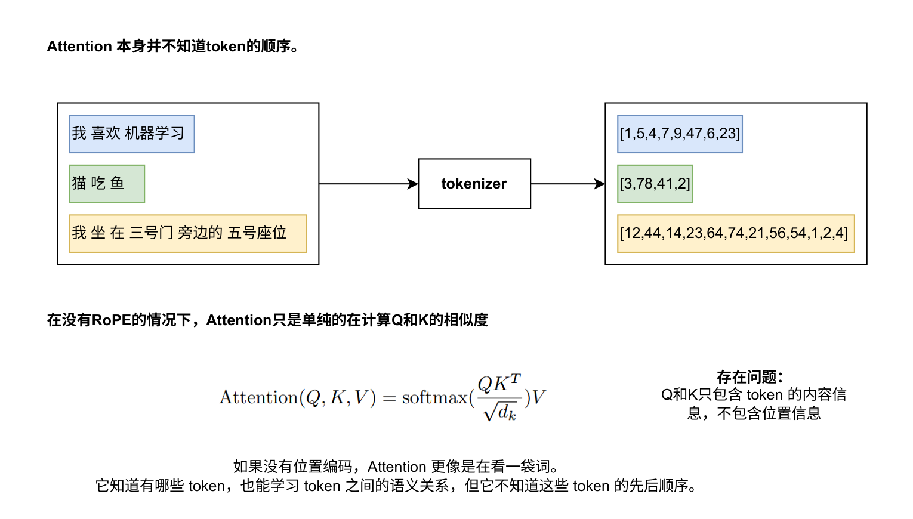
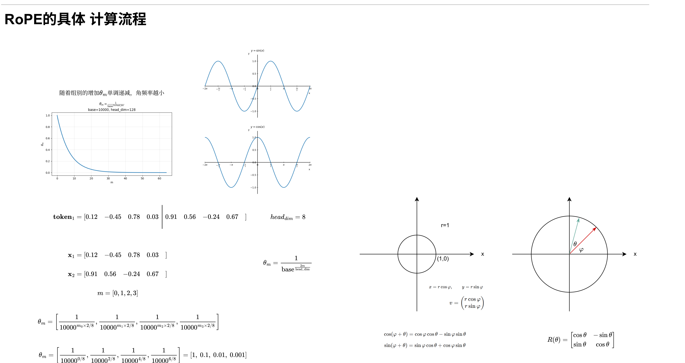

# 第 6 章 RoPE 旋转位置嵌入

注意力本身不知道 token 的先后顺序。RoPE（Rotary Position Embedding，旋转位置嵌入）不把位置向量直接加到词嵌入上，而是在 Query 和 Key 的特征平面中施加与位置相关的旋转。MinivLLM 用一张预计算的余弦、正弦缓存完成这一操作，并针对 Qwen3 与 Llama 3.2 使用不同的频率准备方式。

## 源码定位



*图 6.1　注意力本身并不知道 token 顺序。该图用句子到 token id 的例子引出位置编码的必要性，可作为进入旋转公式之前的问题背景。（原课程课件）*


本章对应以下实现：

- `src/myvllm/layers/rotary_embedding.py`：逆频率、旋转函数、缓存和前向；
- `src/myvllm/models/qwen3.py`：Qwen3 的普通 RoPE 配置及 Q/K 应用位置；
- `src/myvllm/models/llama.py`：Llama 3.2 的频率缩放配置；
- `src/myvllm/engine/model_runner.py`：prefill/decode 的上下文准备。

## 从二维旋转理解 RoPE

对二维向量 \((a,b)\)，旋转角度 \(\theta\) 可写为

\[
R(\theta)
\begin{bmatrix}a\\b\end{bmatrix}
=
\begin{bmatrix}
\cos\theta&-\sin\theta\\
\sin\theta&\cos\theta
\end{bmatrix}
\begin{bmatrix}a\\b\end{bmatrix}
=
\begin{bmatrix}a\cos\theta-b\sin\theta\\a\sin\theta+b\cos\theta\end{bmatrix}.
\]

RoPE 将头维划分为多组二维平面，每组使用不同角速度。若位置为 \(p\)，第 \(j\) 组的旋转角就是 \(p\omega_j\)。这样既能保留向量长度，又能让 Query 与 Key 的内积感知二者的相对位移。

设位置 \(m\) 的 Query 和位置 \(n\) 的 Key 分别受到 \(R_m\) 与 \(R_n\) 作用，则

\[
(R_mq)^\mathsf{T}(R_nk)=q^\mathsf{T}R_m^\mathsf{T}R_nk
=q^\mathsf{T}R_{n-m}k.
\]

所以点积中出现的是相对位置 \(n-m\)。这不意味着注意力输出只由相对位置决定，因为 \(q\) 与 \(k\) 本身仍包含 token 内容和前层计算的信息。

## 实际实现采用“前后半维”配对

`RotaryEmbedding` 接收 `base`、参与旋转的维度数 `rotary_embedding` 和缓存位置上限 `max_position`。记旋转维数为 \(d\)，代码生成 \(d/2\) 个逆频率：

\[
\omega_j=\mathrm{base}^{-2j/d},\qquad j=0,\ldots,d/2-1.
\]

对应源码是：

```python
self.inv_freq = 1 / (
    base ** (torch.arange(0, self.rotary_embedding, 2)
             / self.rotary_embedding)
)
```

配对索引 \(j\) 越大，\(2j/d\) 越接近 1，逆频率越小，旋转周期也越长。不同频率共同表示位置，而不是用一个正弦值编码整个向量。

`apply_rotary_pos_emb` 使用 `x.chunk(2, dim=-1)` 得到 `x1` 和 `x2`。因此第 \(j\) 对元素是

\[
(x[j],\ x[j+d/2]),
\]

即前半维与后半维配对，**不是**相邻元素 \((x[2j],x[2j+1])\) 配对。输出先写所有 `out1`，再写所有 `out2`：

\[
\begin{aligned}
\mathrm{out}_1&=x_1\odot\cos(p\omega)-x_2\odot\sin(p\omega),\\
\mathrm{out}_2&=x_1\odot\sin(p\omega)+x_2\odot\cos(p\omega).
\end{aligned}
\]

阅读其他框架时，必须先确认它采用这种 half-split 布局还是 interleaved 布局。两种形式都可以在各自权重约定下成立，但不能只替换旋转函数而保持权重和维度解释不变。

## 缓存、索引与前向形状

初始化时，代码用 `einsum("i,j -> ij", positions, inv_freq)` 计算所有位置的角度，再分别求余弦和正弦。缓存布局为

```text
cos_sin_cache[p] = [cos(pω_0), ..., cos(pω_{d/2-1}),
                    sin(pω_0), ..., sin(pω_{d/2-1})]
```

其形状是 `[max_position, d]`。`register_buffer` 将它注册为随模型移动设备的非训练状态；前向用整数 `positions` 索引缓存，再 `chunk(2, dim=-1)` 分离 cos 与 sin。

`forward` 对 Query 和 Key 使用同一份位置角度，并分别调用旋转函数；Value 不旋转。函数支持两类输入：

| 模式 | Q/K 形状 | cos/sin 广播后的形状 |
|---|---|---|
| 打包变长序列 | `(total_tokens, num_heads, d)` | `(total_tokens, 1, d/2)` |
| 规则批处理 | `(B, seq_len, num_heads, d)` | `(1, seq_len, 1, d/2)` |

中间插入的维度为 1，因此同位置、不同注意力头共享角度。Query 与 Key 可以具有不同头数，这对 GQA 很重要；只要位置维与头维 \(d\) 对齐，广播不要求二者头数相同。

在张量并行中，每个 rank 持有完整的本地注意力头，位置表和旋转规则在各 rank 上一致，所以 RoPE 可以在本地 Q/K 上独立完成，无需额外集合通信。

## 位置从哪里来

Qwen3 与 Llama 的 DecoderLayer 都在调用注意力前构造 `positions`：

- 打包 prefill：根据 `cu_seqlens_q` 的每条序列长度，生成从 0 开始的位置，序列之间重新归零；
- 单序列 prefill 的后备路径：使用 `torch.arange(x.size(0))`；
- decode：使用 `context.context_lens - 1`，即当前新 token 在完整上下文中的位置。

RoPE 层本身不推断序列边界，只消费这些索引。变长打包之所以不会把上一条序列的末尾位置带入下一条，是因为上层重新生成了位置，而不是缓存自动识别了边界。

若扩展前缀缓存或其他复用路径，还要核对未缓存 Query 的位置是否包含已有前缀长度。当前打包 prefill 的位置构造只依据 `cu_seqlens_q`，不能把它未经检查地套用到所有部分前缀计算场景。

## Qwen3：直接缓存普通 RoPE 频率



*图 6.2　RoPE 把不同维度组看作具有不同角频率的二维旋转：位置决定旋转角，前后半维通过 sin、cos 组合。公式、频率曲线和单位圆三种视角可以相互校验。（原课程课件）*


Qwen3Attention 按以下方式构造旋转层：

```python
self.rotary_emb = RotaryEmbedding(
    base=base,
    rotary_embedding=head_dim,
    max_position=max_position,
)
```

`is_llama3` 保持默认的 `False`，所以逆频率不做额外修正，直接由 `base` 和 `head_dim` 生成。类定义中的默认值是 `base=10000`、`max_position=16384`；实际运行时应以传入配置为准。

Qwen3 在 `qkv_bias is False` 的路径中还会于 RoPE 之前对 Q/K 做归一化，而 Llama 3.2 没有这两个归一化层。这是模型结构差异，不属于旋转公式本身。两种模型的旋转函数、半维配对和缓存索引方式是相同的，主要 RoPE 差别发生在 `inv_freq` 的准备阶段。

## Llama 3.2：按波长缩放部分频率

LlamaAttn 设置 `is_llama3=True`。当前模型未显式传入其他缩放参数，因此使用 RotaryEmbedding 构造函数的默认值：缩放因子 32，高频因子 4，低频因子 1，原始最大位置 8192。Llama 模型类中的 `rope_base` 和 `max_position_embeddings` 默认分别为 500000 和 131072，运行时同样应由配置决定。

该分支先计算每个逆频率对应的波长

\[
\lambda_j=\frac{2\pi}{\omega_j},
\]

再定义经过截断的平滑权重：

\[
s_j=\operatorname{clamp}\left(
\frac{L_0/\lambda_j-f_{low}}{f_{high}-f_{low}},0,1
\right),
\qquad
c_j=\frac{1-s_j}{32}+s_j.
\]

最终使用 \(\omega'_j=c_j\omega_j\)，然后才建立 cos/sin 缓存。其效果是：

- 波长较长、频率较低的部分，\(s=0\)，逆频率除以 32，旋转变慢；
- 波长较短、频率较高的部分，\(s=1\)，保留原逆频率；
- 中间频段连续过渡，而不是统一压缩所有位置。

当 `low_freq_factor == high_freq_factor` 时，代码退化为按 `original_max_position / high_freq_factor` 划分波长的硬阈值分支，没有平滑区。该实现对应本仓库 Llama 3.2 的固定频率缩放规则，不应泛化为所有 Llama 版本的唯一 RoPE 配置。

## 长上下文：缓存长度不等于外推能力

`max_position` 只决定缓存表能索引到哪个位置。把它调大可以让更大的整数索引有表可查，却不会自动让模型学会训练时未见过的位置分布；位置大于等于该值还会导致缓存索引越界。显存允许和索引有效，也不等于长文本质量得到保证。

常见长上下文思路需要区分：

1. **直接外推。** 沿用原频率和更长位置表，最简单，但超出训练范围后可能退化。
2. **位置插值。** 用 \(p/s\) 的等效角度压缩位置，等价于将相应逆频率整体除以 \(s\)。当前缓存以整数位置为索引，不能只传入浮点缩放位置；应重新计算角度和缓存。
3. **调整 base。** 更大的 base 会降低 \(j>0\) 的几何频率、拉长周期，但也改变了模型训练时所见的编码，不能视为无成本开关。
4. **分频段缩放。** Llama 3.2 分支保留短波长高频、压缩长波长低频，并对中间频段平滑处理。
5. **YaRN、NTK 等策略。** 项目路线文档把它们列为长上下文学习方向，但当前 `rotary_embedding.py` 没有通用的 YaRN 或动态 NTK 实现，Qwen3 路径也没有位置插值参数。需要新增算法、配置和模型质量验证，不能只修改 `max_position`。

因此，“Qwen3 与 Llama 的差异”应准确表述为：前者在当前代码中使用未缩放的普通逆频率，后者在建表前应用 Llama 3.2 特定的分频段缩放；两者最终共用同一个旋转核。

## 关键设计

1. **旋转只作用于 Q/K。** Value 保持内容表示，注意力分数通过 Q/K 点积获得位置信息。
2. **频率建表与旋转执行分离。** Llama 3.2 的特化只需修改建表前的 `inv_freq`，无需复制两套前向。
3. **维度布局是权重契约。** 当前实现是半维配对，不能误写成相邻配对。
4. **位置是上层输入。** 打包边界、decode 当前位置与前缀偏移都需要调用方负责。
5. **长上下文包含算法和评估。** 缓存可寻址、模型可运行和生成质量可靠是三个不同问题。

## 实践检查

1. 令 \(d=4\)，手工列出两对维度 `(0,2)`、`(1,3)`，用二维旋转公式逐项对照 `apply_rotary_pos_emb`，专门排除相邻配对误解。
2. 在位置 0 检查 cos 为 1、sin 为 0，输出应保持不变；再对随机 Q/K 检查每个二维平面的模长及整体范数在浮点误差允许范围内保持。
3. 分别构造三维打包输入和四维批处理输入，让 Q 与 K 使用不同头数，检查广播形状和输出形状。每条打包序列的位置都应从 0 重新开始。
4. 对同一组 Q/K 比较位置差相同的不同绝对位置组合，验证点积的相对位置性质；不要把完整注意力输出也当作只依赖相对位置。
5. 在 `is_llama3=True` 时打印原始与缩放后的 `inv_freq`、波长和 smooth，确认高频端不变、低频端除以 32，中间端连续过渡。
6. 检查 `max_position - 1` 是最后有效索引，并将更大位置作为预期越界测试。若要验证长上下文策略，应另外设计长文本任务评估，而不报告未经测量的质量或性能结论。

## 小结

RoPE 以不同频率在 Q/K 的二维平面中旋转特征，使点积自然包含相对位置信息。MinivLLM 使用前后半维配对、预计算 cos/sin 缓存以及适配变长和批处理输入的广播；Qwen3 直接使用普通逆频率，Llama 3.2 则先按波长进行分频段缩放。`max_position` 只扩展位置表，长上下文外推还需要正确的位置构造、匹配的缩放算法和独立的质量验证。

## 参考资料

- MinivLLM：`src/myvllm/layers/rotary_embedding.py`。
- MinivLLM：`src/myvllm/models/qwen3.py`、`src/myvllm/models/llama.py`。
- MinivLLM：《HowToApproachvLLM_zh》“旋转位置编码（RoPE）”一节。
- [RoFormer：Enhanced Transformer with Rotary Position Embedding](https://arxiv.org/abs/2104.09864)。
- [Llama 3.2 模型配置参考](https://huggingface.co/meta-llama/Llama-3.2-1B-Instruct/blob/main/config.json)。
