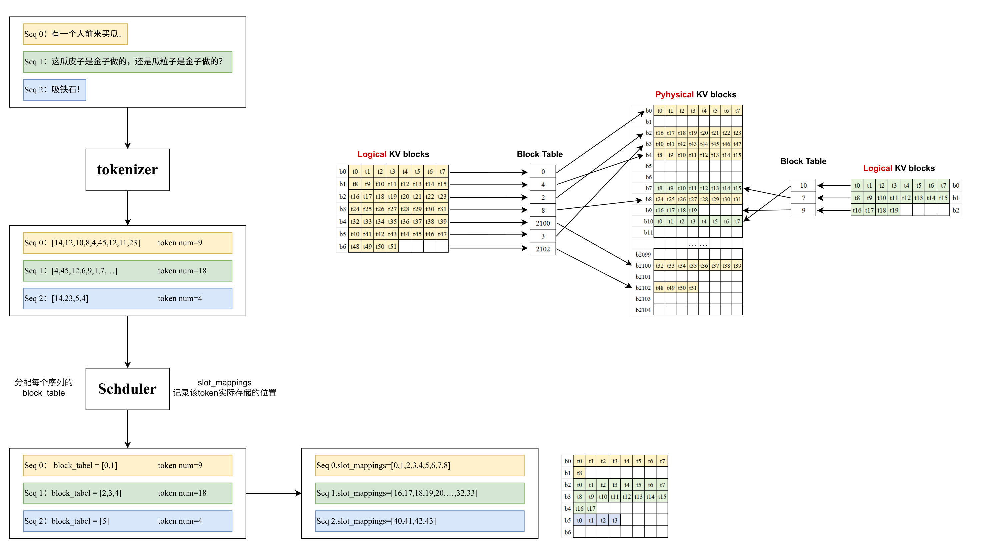
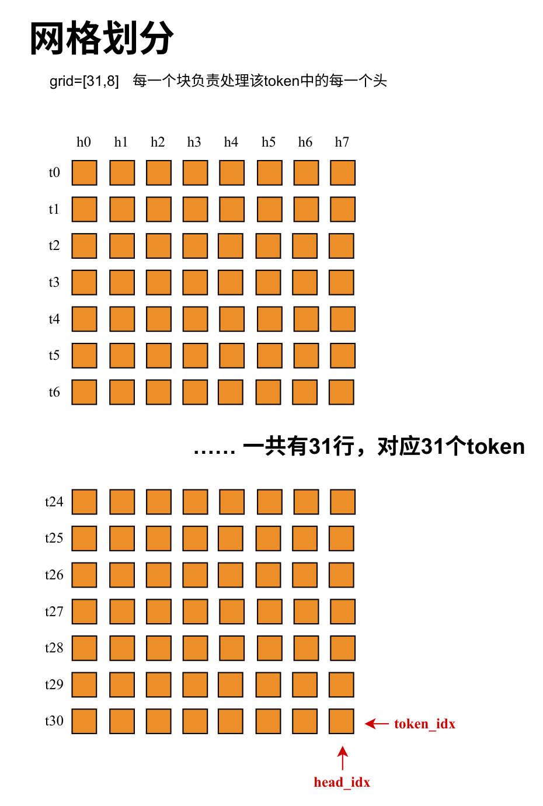
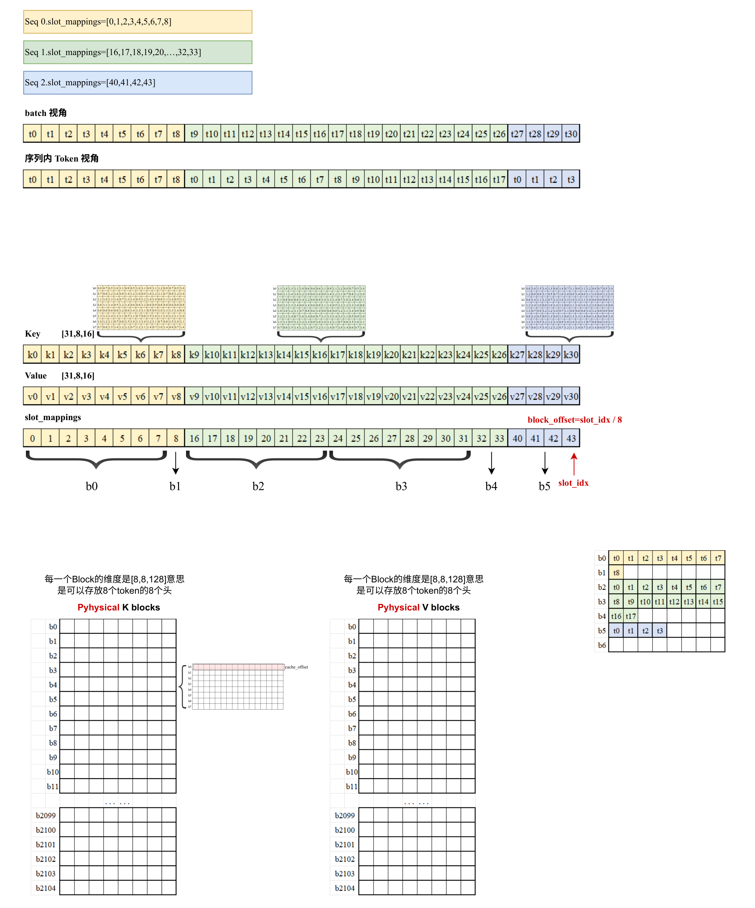

# 第 7 章 KV Cache 内存布局与 Triton 写入

自回归推理每产生一个 token，都要重新访问此前各层的 K、V。若每一步重复计算这些投影，计算量会随上下文增长；若把每次请求的缓存分别放在连续大张量中，动态扩容和请求结束又会带来复制与碎片。MinivLLM 采用折中方案：所有层共享一个按固定块划分的缓存池，每条序列用 block table 记录自己占用的物理块。

本章先确定“逻辑 token 在哪里、物理元素怎样寻址”，再阅读 `store_kvcache_kernel`。写入路径看似只是两次拷贝，却是后续 prefill、decode 正确性的共同前提：块号、块内槽位、KV 头或维度任何一项错位，都会让注意力读到合法地址中的错误数据。

## 源码定位与执行顺序



*图 7.1　左列说明每条序列如何获得 block_table 与 slot_mappings，右列说明逻辑块号如何指向不连续的物理块。把两条映射链连起来，就能理解逻辑 token 最终落入哪个缓存槽位。（原课程课件）*


本章对应仓库根目录下的以下文件；行号以当前源码为准。

| 位置 | 内容 |
|---|---|
| `src/myvllm/layers/attention.py:7-108` | `store_kvcache_kernel` 及其启动包装器 |
| `src/myvllm/layers/attention.py:455-518` | `Attention.forward` 先写缓存，再按阶段计算注意力 |
| `src/myvllm/engine/model_runner.py:196-253` | 估算容量、分配各层 K/V 缓存视图 |
| `src/myvllm/engine/model_runner.py:265-343` | prefill、decode 的 `slot_mapping` 与 block table 准备 |
| `src/myvllm/engine/sequence.py:62-80` | 块数、末块 token 数和逻辑块切片 |
| `src/myvllm/engine/block_manager.py:50-113` | 物理块分配、引用计数与块表建立 |

一次模型层调用的顺序是：QKV 投影与 RoPE 得到当前 token 的 `q、k、v`；`Attention.forward` 根据 `slot_mapping` 写入本轮新的 K/V；随后 prefill 直接读取本轮打包的 `k、v`，decode 则通过 block table 读取缓存池。由此可见，**写入地址与读取地址必须使用同一套布局约定**。

## 从逻辑 token 到物理槽位

设每块容纳 $B$ 个 token，即 `block_size=B`。序列内逻辑位置为 $t$ 的 token 满足：

$$
\ell=\left\lfloor t/B\right\rfloor,\qquad s=t\bmod B,\qquad p=\text{block\_table}[b,\ell]
$$

其中 $b$ 是批次中的序列号，$\ell$ 是逻辑块号，$s$ 是块内槽位，$p$ 是缓存池中的物理块号。最后定义扁平槽位：

$$
\operatorname{slot}=pB+s
$$

`slot_mapping[token]` 保存的正是这个**物理槽位**，不是逻辑位置 $t$，也不是单纯的物理块号。假设 `B=4`、某序列的块表为 `[7, 2, 11]`，逻辑 token `t=6` 位于逻辑块 1、槽位 2，因此物理块为 2、扁平槽位为 `2*4+2=10`。块表不要求递增，相邻逻辑块也无需相邻存放。

固定块分配把外部碎片转化为池内可复用的空闲块，代价主要是末块未填满的内部空间。$B$ 是存储容量参数；第 8、9 章的 `BLOCK_N` 是计算分块参数，两者不能混为一谈，也不要求互为整数倍。

## 四维 KV Cache 的元素偏移

每层都有两个连续张量：

```text
k_cache, v_cache: (num_blocks, block_size, num_kv_heads, head_dim)
```

记 KV 头数为 $H_{kv}$，头维为 $D$。元素 `(p, s, h, d)` 相对本层 K 或 V 基指针的偏移为：

$$
\begin{aligned}
\operatorname{off}_{cache}
&=(((pB+s)H_{kv}+h)D+d)\\
&=pBH_{kv}D+sH_{kv}D+hD+d
\end{aligned}
$$

该公式以**元素数**为单位；若元素占 $e$ 字节，字节偏移还需乘以 $e$。K、V 使用相同的元素偏移，但基指针不同。最内层 `d` 连续，因此一个 program 可以用 `tl.arange(0, head_dim)` 一次加载或写回整个头向量。

写入前，当前 K/V 的形状为 `(num_tokens, Hkv, D)`。第 $t$ 个打包 token、第 $h$ 个 KV 头的输入偏移则是：

$$
\operatorname{off}_{in}=tH_{kv}D+hD+d
$$

这两个公式共同构成一次写入：从 `key_ptr + off_in` 读，向 `k_cache_ptr + off_cache` 写；V 完全同理。包装器先把非连续的 `key、value` 转为连续张量，才能省略显式 stride 而直接使用上述乘法。

## 缓存池怎样分配到每一层



*图 7.2　store_kvcache 的每个 Triton program 负责一个 token 的一个 KV 头：program_id(0) 对应 token_idx，program_id(1) 对应 head_idx。图中省略号表示中间 token 行，而不是额外计算维度。（原课程课件）*


`ModelRunner.allocate_kv_cache` 先 warmup，估算模型执行所需的峰值显存，再按每 rank 的本地 KV 头数分配一个共享张量：

```python
allocated_kv_cache = torch.zeros(
    2, num_layers, max_cached_blocks,
    block_size, num_kv_heads_local, head_dim, device=f"cuda:{rank}"
)
module.k_cache = allocated_kv_cache[0, layer_id]
module.v_cache = allocated_kv_cache[1, layer_id]
```

一个物理块跨所有层、同时包含 K 和 V 所需的字节数为：

$$
C_{block}=2L B H_{kv,local}D e
$$

其中 $L$ 是层数。可用块数由 `available_mem // C_block` 决定；张量并行为 $W$ 时，本实现使用 `num_kv_heads // world_size` 计算本地头数。多 rank 还会对可分配块数做 `MIN` 归约，避免调度器按照显存较多的 rank 超配。这里的 `max_cached_blocks` 是全局共享池的块数，不是每条序列独享的块数。

## ModelRunner 如何生成 slot_mapping

prefill 遍历序列尚未缓存的块。完整块生成一整段 `block_id*B ... (block_id+1)*B-1`，末块只生成 `last_block_num_tokens` 个槽位，因而不必写入块尾的空闲位置。

decode 每条序列只有一个当前 token，其位置直接由末块和末块长度得到：

```python
new_slot = (seq.block_table[-1] * self.block_size
            + seq.last_block_num_tokens - 1)
context_lens.append(len(seq))       # 包含这个当前 token
slot_mappings.append(new_slot)
```

例如末块原有 5 个 token，加入当前 token 后 `last_block_num_tokens=6`，新 token 的槽位下标就是 5。`BlockManager.append` 已在新块需要出现时更新块表，所以这里无需在 kernel 中分配内存。

`slot_mapping=-1` 表示跳过，不对应任何物理存储。CUDA Graph 使用大于实际批次的固定缓冲区时，未使用的写入槽也会被填成 `-1`。

## Triton 写入的网格映射

启动网格为 `(num_tokens, num_kv_heads)`。一个 Triton program 不是一个 CUDA 线程，而是一份可包含向量指令的程序实例。本 kernel 的映射如下：

| program 分量 | 职责 | 向量部分 |
|---|---|---|
| `tl.program_id(0)` | 一个打包 token，读取一个 `slot_mapping` | 无 |
| `tl.program_id(1)` | 一个 KV 头 | `offs_d` 覆盖 `head_dim` |

核心代码可以压缩为下面的形式：

```python
slot_idx = tl.load(slot_mapping_ptr + token_idx)
if slot_idx == -1:
    return
block_idx = slot_idx // block_size
block_offset = slot_idx % block_size
input_offset = (token_idx * num_kv_heads * head_dim
                + head_idx * head_dim + head_offsets)
cache_offset = (block_idx * block_size * num_kv_heads * head_dim
                + block_offset * num_kv_heads * head_dim
                + head_idx * head_dim + head_offsets)
key = tl.load(key_ptr + input_offset)
value = tl.load(value_ptr + input_offset)
tl.store(k_cache_ptr + cache_offset, key)
tl.store(v_cache_ptr + cache_offset, value)
```

每个有效 `(token, head)` 只由一个 program 写入，K、V 又位于不同分配区，因此正常情况下没有写竞态。这一无竞态结论依赖“同一批次有效槽位不重复”的调度与块管理约定，而不是由 Triton 自动保证。

## 跳过语义与 64 位地址



*图 7.3　读图时应沿着“token 与头—slot_idx—block_idx 和块内偏移—cache_offset”逐层下降。它把四维缓存的逻辑形状展开为指针偏移，正好对应 Triton 写入内核中的地址计算。（原课程课件）*


写入 kernel 用提前返回处理 `-1`，所以负槽位不会进入后续地址计算。`ModelRunner` 将 `slot_mapping` 构造为 `torch.long`，加载出的槽位及由其派生的块号可保持 64 位；这对于大缓存池的 `block_idx * block_size * Hkv * D` 很重要。

读取侧还有另一种风险：向量 `tl.load(..., mask=...)` 只屏蔽访存，不会阻止各 lane 的地址表达式求值。第 9 章因此在计算缓存偏移前把无效物理块钳到 0，并在乘法前转为 `int64`。提前返回和地址钳制分别服务于当前写入、读取路径，不能相互替代。

## 正确性检查

下面的最小检查使用非连续物理槽位，并包含一个跳过项；应在支持 Triton 的 CUDA 环境中运行：

```python
import torch
from myvllm.layers.attention import store_kvcache

T, H, D, B = 4, 2, 64, 3
key = torch.randn(T, H, D, device="cuda", dtype=torch.float16)
value = torch.randn_like(key)
kc = torch.zeros(3, B, H, D, device="cuda", dtype=key.dtype)
vc = torch.zeros_like(kc)
slots = torch.tensor([8, -1, 0, 4], device="cuda", dtype=torch.long)
store_kvcache(key, value, kc, vc, slots, B)
for t, slot in enumerate(slots.cpu().tolist()):
    if slot >= 0:
        p, s = divmod(slot, B)
        torch.testing.assert_close(kc[p, s], key[t], rtol=0, atol=0)
        torch.testing.assert_close(vc[p, s], value[t], rtol=0, atol=0)
```

还应检查三类不变量：写入前后目标槽位的数值确实变化且与源一致；`-1` 不修改任何槽位；打乱物理块顺序后结果仍一致。最后再用独立的 PyTorch 索引公式检查 `kc.view(-1)[off_cache]`，可避免测试和 kernel 同时犯同一个“块号与槽位混淆”错误。

## 实践

1. 取 `B=5`、块表 `[9, 1, 6]`，手算 `t=0、4、5、12` 的 $(\ell,s,p,\operatorname{slot})$，再代入元素偏移公式。
2. 把上面的测试改为 `B=1、3、7`，验证存储块大小不必是 2 的幂；保持 `head_dim=64`，避免把 `tl.arange` 的约束与本节讨论的任意 `block_size` 混淆。
3. 故意把 `block_offset` 改成逻辑 token 下标，观察单块测试为何可能通过、跨块测试为何失败，然后恢复正确公式。
4. 按当前模型层数、dtype 和每 rank KV 头数计算 `C_block`，说明为什么只统计一张 `(num_blocks,B,H,D)` 张量会低估总显存。

## 小结

KV Cache 的核心约定是“块表描述逻辑到物理的映射，四维连续布局描述块内元素排列”。`slot_mapping=pB+s` 将二者连接，Triton 以 `(token, KV head)` 为网格完成整头向量写入。ModelRunner 负责分配槽位，kernel 负责忠实拷贝；64 位槽位、`-1` 跳过、独立参考索引和非连续块表测试共同保证这条路径可信。

## 参考资料

- MinivLLM 仓库：`src/myvllm/layers/attention.py`、`src/myvllm/engine/model_runner.py`。
- [MinivLLM 官方技术路线：注意力层与 KV Cache](https://github.com/Wenyueh/MinivLLM/blob/main/HowToApproachvLLM_zh.md)。
- Kwon 等，[Efficient Memory Management for Large Language Model Serving with PagedAttention](https://arxiv.org/abs/2309.06180)。
- [Triton 语言文档](https://triton-lang.org/main/python-api/triton.language.html)。
