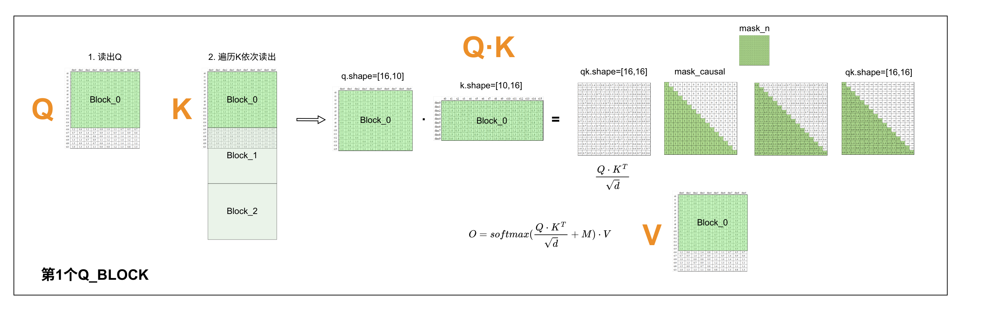
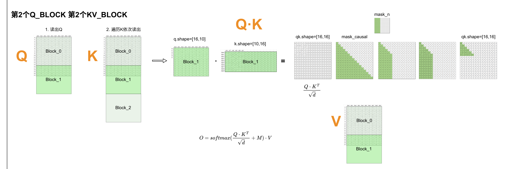
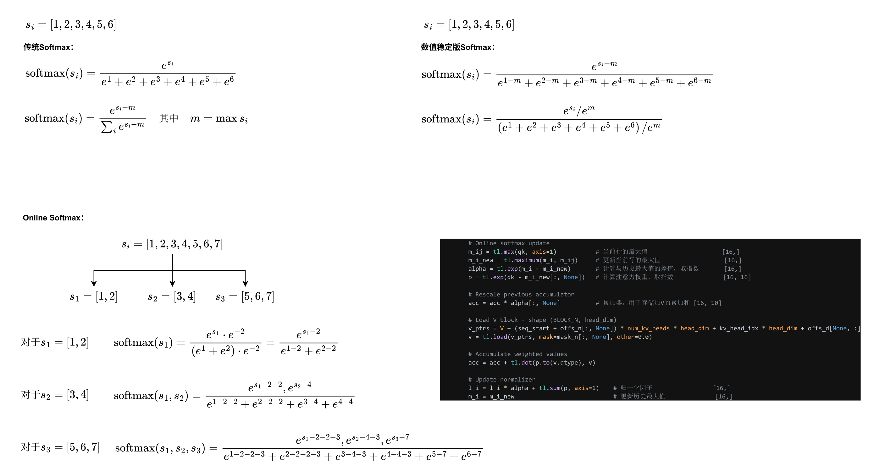

# 第 8 章 Prefill：变长 FlashAttention 与 Online Softmax


*图 8.1　FlashAttention 解决分块计算和在线归一化，PagedAttention 解决 KV Cache 的块存储与间接寻址。MinivLLM 在 Prefill 使用前者并建立缓存，在 Decode 将分页读取、分块扫描和 online softmax 组合起来。（SVG 示意图）*

prefill 要在一个批次中处理多个不同长度的 prompt。直接为每条序列填充到最大长度会浪费计算和显存；逐条启动注意力又会增加主机循环与启动开销。MinivLLM 将 token 首尾相接，用累积长度描述边界，再以一个三维 Triton 网格并行处理所有序列、头和 query 块。

本章的核心不是“把标准注意力换成一个更快的 API”，而是理解两项独立设计：varlen 打包解决**批次形状不规则**，FlashAttention 的分块与 online softmax 解决**完整分数矩阵带来的存储和访存压力**。PagedAttention 则属于缓存存储维度；三者相关，但不能互相替代。

## 源码定位



*图 8.2　第一个 Q 块展示了分块注意力的完整数据流：QK 矩阵不必扩展到完整序列，而是在当前块内计算并施加 mask。下三角因果区域与尾部的 mask_n 共同决定哪些得分可以保留。（原课程课件）*


| 位置 | 内容 |
|---|---|
| `src/myvllm/layers/attention.py:111-209` | `flash_attention_varlen_kernel` 的网格、mask 与 online softmax |
| `src/myvllm/layers/attention.py:212-280` | `flash_attention_prefill` 的块大小和启动参数 |
| `src/myvllm/layers/attention.py:472-518` | 写入新 K/V 后按 `context.is_prefill` 选择计算路径 |
| `src/myvllm/engine/model_runner.py:265-314` | 打包输入并构造 `cu_seqlens_q/k` |
| `benchmark_prefilling.py:9-291` | PyTorch、朴素 Triton 与 FlashAttention 的对照实现 |
| `benchmark_prefilling.py:411-502` | 数据生成、预热、计时与短序列交叉点实验 |

当前 `Attention.forward` 的 prefill 调用只传入 `q、k、v、cu_seqlens_q`。尽管 ModelRunner 也准备了 `cu_seqlens_k` 和可能的 `block_tables`，这个 kernel 并不消费它们。这个事实是理解本实现能力边界的起点。

## FlashAttention 与 PagedAttention 的正交关系

**FlashAttention 是计算技术**：将 Q、K、V 分块，在每个块内计算局部分数，再用 online softmax 合并，不生成完整的 $N\times N$ 分数矩阵。**PagedAttention 是存储技术**：K/V 位于固定大小的物理块中，通过 block table 间接寻址，降低动态缓存管理的碎片与复制成本。

| 阶段 | 本仓库的计算方式 | K/V 来源 | 是否使用 paged 读取 |
|---|---|---|---|
| prefill | Q/K/V 分块，逐行 online softmax | 本轮刚算出的连续 varlen `k、v` | 否 |
| decode | 单个 query，对 KV 分块并 online softmax | block table 指向的 KV Cache | 是 |

所以二者不是“prefill 用 Flash、decode 用 Paged”的二选一。**decode 同时是分块 online softmax 和 paged KV；本仓库当前 prefill 是 flash 加 varlen 连续读取。** 一种实现也可以让 prefill 从 paged cache 读取历史，那需要另一个支持 Q/K 长度不同的 kernel，而不是修改名称就能获得。

## 变长序列打包

设批次有 $S$ 条序列，长度分别为 $N_0,\ldots,N_{S-1}$。打包后 Q 的形状为 `(total_tokens,H,D)`，K/V 为 `(total_tokens,Hkv,D)`，其中：

$$
T=\sum_{i=0}^{S-1}N_i,\qquad c_0=0,\qquad c_{i+1}=c_i+N_i
$$

`cu_seqlens=[c0,...,cS]` 保存边界，第 $i$ 条序列对应半开区间 $[c_i,c_{i+1})$。例如 `[0,5,12,20]` 表示长度 5、7、8 的三条序列，而不是四个序列。

对第 $i$ 条序列内的局部位置 $m,n$，全局 token 下标分别是 $c_i+m,c_i+n$。Q 与输出的元素偏移为：

$$
\operatorname{off}_Q=(c_i+m)HD+hD+d
$$

K、V 只需把 $H$ 换成 $H_{kv}$，把 query 头 $h$ 换成 `kv_head_idx`。GQA 的映射为：

$$
h_{kv}=\left\lfloor h/(H/H_{kv})\right\rfloor
$$

因此多个 query 头可以读取同一个 KV 头，而无需在 kernel 前调用 `repeat_interleave` 复制缓存。

## 三维网格与局部地址



*图 8.3　与第一个 Q 块对照，可以看到块索引推进后因果有效区如何变化。该图适合用来核对 offs_m、offs_n、mask_causal 与 mask_n 的组合，而不是只背一个下三角掩码公式。（原课程课件）*


`head_dim<=64、<=128、更大` 时，包装器分别选择 `(BLOCK_M,BLOCK_N)=(64,64)、(32,32)、(16,16)`。以 $M、N$ 分别表示 `BLOCK_M、BLOCK_N`，启动网格为：

```python
grid = (triton.cdiv(max_seq_len, BLOCK_M), num_heads, num_seqs)
```

| 网格轴 | program 含义 | 越界处理 |
|---|---|---|
| 0 | 序列内第 `start_m` 个 query 块 | `start_m*M >= seq_len` 时整组返回 |
| 1 | 第 `off_h` 个 query 头 | 由网格范围保证 |
| 2 | 第 `seq_idx` 条打包序列 | 由 `cu_seqlens` 取得起止边界 |

一个 program 的 `offs_m=start_m*M+arange(M)`，有效 query 行满足 `offs_m<seq_len`。Q 块形状为 `(M,D)`；K 按 `(D,N)` 加载，V 按 `(N,D)` 加载，`tl.dot(q,k)` 得到 `(M,N)` 的局部分数。输出按与 Q 相同的偏移写回，并用 `mask_m` 丢弃补齐行。

网格第一轴按全批次最大长度启动，短序列多余的 program 提前退出。包装器还会在主机端执行 `cu_seqlens.cpu()` 和 `.max().item()` 求最大长度；因此基准中的“单次调用”不只是设备上的矩阵计算，还包含主机准备与同步路径。

## 因果 mask 与边界 mask

第 $i$ 条序列中，局部 query 位置 $m$ 只能访问 $n\le m$。kernel 写成：

```python
mask_causal = (offs_m[:, None] + seq_start) >= (offs_n[None, :] + seq_start)
qk = tl.where(mask_causal & mask_n[None, :], qk, -1e10)
```

两边的 `seq_start` 在比较中可以约去，结果仍是局部因果条件 `offs_m>=offs_n`。加上它有助于确认比较发生在同一序列的全局坐标中。`mask_n` 排除序列尾部之外的 K/V；`mask_m` 则保护 Q 的加载与 O 的存储。

当前实现循环 `cdiv(seq_len,BLOCK_N)` 个 KV 块，即使某一块完全位于某些 query 的未来，也先计算再施加 mask。这是简洁的教学实现，不应把它误解为“已经跳过所有未来块的计算”。此外，mask 填入的是有限的 `-1e10` 而非 `-inf`，不能笼统地认为 masked 项在每个中间状态都严格不贡献。

## Online Softmax 为什么能分块合并

标准稳定 softmax 先求整行最大值。分块时看不到未来的分数，因此需要同时维护三个状态：目前最大值 $m$、未归一化分母 $\ell$、未归一化输出累加器 $a$。

处理新块 $j$ 时，令其中的分数为 $s_{j,n}$，对应值为 $V_{j,n}$，更新规则为：

$$
m'=\max(m,\max_n s_{j,n}),\qquad \alpha=\exp(m-m')
$$

$$
a'=\alpha a+\sum_n\exp(s_{j,n}-m')V_{j,n}
$$

$$
\ell'=\alpha\ell+\sum_n\exp(s_{j,n}-m')
$$

所有块处理完后输出 $a/\ell$。$\alpha$ 的作用是把旧状态从旧基准 $m$ 换算到新基准 $m'$；它不改变最终 softmax，只改变指数计算的共同参考点。对任意有效 query，至少位置 0 可见，所以最终 $\ell>0$。

源码中的关键循环对应为：

```python
m_ij = tl.max(qk, axis=1)
m_i_new = tl.maximum(m_i, m_ij)
alpha = tl.exp(m_i - m_i_new)
p = tl.exp(qk - m_i_new[:, None])
acc = acc * alpha[:, None]
acc = acc + tl.dot(p.to(v.dtype), v)
l_i = l_i * alpha + tl.sum(p, axis=1)
m_i = m_i_new
acc = acc / l_i[:, None]  # 循环结束后归一化
```

`m_i、l_i` 是每行一个的 FP32 向量，`acc` 是 `(M,D)` 的 FP32 状态。局部 `(M,N)` 分数仍会存在，但其大小不随完整 $N^2$ 增长；这就是“避免完整矩阵”而不是“完全不产生分数”。

有限 mask 需要区分中间状态与最终结果。若某次更新对一行而言整个 KV 块都被 mask，且旧的 `m_i` 与本块最大值都仍为 `-1e10`，就有 `m_i_new=-1e10`、`alpha=exp(0)=1`，以及 `p=exp(-1e10-(-1e10))=1`。此时 `acc` 会累加对应的 V，`l_i` 也会累加这些 `p`，所以不能说 masked 项从不贡献。

后续一旦出现普通的有限有效最大值，`alpha=exp(-1e10-m_i_new)` 通常会下溢为 0，把此前的分子和分母一起清掉；在新最大值下，当前 masked 项的 `p` 也通常下溢为 0。若有限最大值在全未来块之前已经建立，未来项则会直接得到这种近零权重。因此最终结果通常仍等价于有效位置上的 softmax，但这是后续重缩放和数值下溢的结果，不是“mask 在每个中间步骤严格置零”的保证。

应为此增加专项测试：构造全未来块，检查中间 `p、l_i、acc` 是否出现上述暂时累积，再把有限 `-1e10` 与真正 `-inf` 的实现及 PyTorch 参考结果对照；最终输出测试与中间状态检查不能互相替代。

## 存储复杂度与两种朴素实现



*图 8.4　Online Softmax 的核心是用新的历史最大值重缩放旧累加结果，再把当前块纳入，因此无需一次性保存全部注意力分数。左侧公式与右侧 m_i、alpha、acc、l_i 的更新可逐行对应。（原课程课件）*


PyTorch 对照实现显式构造每个头的 `(seq_len,seq_len)` 分数与概率张量，GQA 时还会 `repeat_interleave` K/V。它直观且适合参考，但会产生完整中间矩阵和额外 kernel。

`naive_triton_attention_kernel` 一次装入整条短序列，并构造 `(BLOCK_SIZE,BLOCK_SIZE)` 的片上局部 `qk`。这里的“$O(N^2)$”描述该算法需要保留的二次方分数状态，不应误读为一定在 HBM 中分配一张完整矩阵。它受片上资源限制，而且 `seq_len>BLOCK_SIZE` 会直接返回，包装器只打印警告，长序列结果并不完整。

Flash 版本的临时状态随块大小和头维增长，输出大小为 $O(THD)$。它减少的是完整分数矩阵的存储与往返流量，不会消除 $QK^T$ 和 $PV$ 本身的计算；短序列上更多 program、主机同步和启动成本也可能抵消收益，必须实测而非仅凭复杂度判断快慢。

## 当前实现的前缀缓存边界

`prepare_prefill` 已分别维护 `seqlens_q` 与 `seqlens_k`，但 `flash_attention_varlen_kernel` 只接收 `cu_seqlens_q`，并假设 Q 和本轮 K/V 有相同边界。它既没有从 `context.block_tables` 读历史 KV，也没有给 RoPE 位置额外加上 `num_cached_tokens` 的参数。

因此，本章代码适用于“当前传入的打包 prompt 自包含”的 prefill。若要在现有 paged KV 架构中复用已有前缀，至少需要支持 $Q$ 只含未缓存 token、$K/V$ 覆盖完整上下文、历史部分经 block table 读取，并保证因果条件使用正确绝对位置。不能仅把旧 cache 拼到输入后仍沿用现有 mask。

## 正确性检查

`benchmark_prefilling.py` 已提供逐序列、带 GQA 和 causal mask 的 PyTorch 参考。测试应使用不等长序列，而不是只调用等长的 `setup_data`：

```python
import torch
from benchmark_prefilling import pytorch_standard_attention, flash_attention

lengths, H, Hkv, D = [1, 5, 33, 70], 4, 2, 64
T = sum(lengths)
cu = torch.tensor([0] + torch.tensor(lengths).cumsum(0).tolist(),
                  device="cuda", dtype=torch.int32)
q = torch.randn(T, H, D, device="cuda", dtype=torch.float16)
k = torch.randn(T, Hkv, D, device="cuda", dtype=torch.float16)
v = torch.randn_like(k)
scale = D ** -0.5
ref = pytorch_standard_attention(q, k, v, cu, scale, H, Hkv, D)
out = flash_attention(q, k, v, cu, scale, H, Hkv, D)
torch.testing.assert_close(out, ref, rtol=2e-2, atol=2e-2)
```

除最大误差外，还应检查：长度 1 不会除零；跨 `BLOCK_M/BLOCK_N` 边界的位置没有遗漏；交换序列顺序只置换相应输出区间；把 K/V 的未来位置改成极大值不会改变先前 query 的输出。最后一项能直接检验因果 mask，而不仅是比较一个随机样例。

## 实践：先验证，再测量

1. 运行 `uv run python benchmark_prefilling.py`，分别记录正确性检查、GPU/驱动/PyTorch/Triton 版本和完整 Python 调用口径。
2. 将长度改为 `[1,31,32,33,63,64,65]`，覆盖块边界；再改变 `num_heads/num_kv_heads`，检查 GQA 映射。
3. 用两个 KV 块手算一次 $(m,\ell,a)$ 合并，与一次性稳定 softmax 对照，确认 $\alpha$ 同时缩放旧分子和旧分母。
4. 分析 `find_crossover_point` 时，不要把“朴素版本因长度超限而跳过”写成 Flash 的实测加速，也不要把一次调用的耗时当成完整模型吞吐。

官方技术路线说明原始开发与测试环境为单张 A6000，但其公开量化表集中在 decode；本章没有可对应引用的官方 prefill 性能表，**未在本地复测，也不填造 prefill 性能数字**。读者自行得到的数据应标为自己的环境与结果。

## 小结

varlen 打包用 `cu_seqlens` 保留序列边界，三维网格把 query 块、头和序列映射到独立 program。FlashAttention 通过局部 QK/PV 与 online softmax 的 $(m,\ell,a)$ 递推避免完整分数矩阵；PagedAttention 则解决 KV 的物理存储，两者正交。有限 `-1e10` mask 在全 masked 块中可能产生暂时的非零累积，后续有限最大值通常经 `alpha` 下溢清除，需分别检查中间状态和最终结果。当前 prefill 直接读本轮连续 K/V，不能误称为已支持 paged 前缀复用。跨边界、变长、GQA 和因果性检查应先于任何性能结论。

## 参考资料

- MinivLLM 仓库：`src/myvllm/layers/attention.py`、`src/myvllm/engine/model_runner.py`、`benchmark_prefilling.py`。
- [MinivLLM 官方技术路线：FlashAttention、PagedAttention 与 online softmax](https://github.com/Wenyueh/MinivLLM/blob/main/HowToApproachvLLM_zh.md)。
- Dao 等，[FlashAttention: Fast and Memory-Efficient Exact Attention with IO-Awareness](https://arxiv.org/abs/2205.14135)。
- Dao，[FlashAttention-2: Better Attention with Better Parallelism and Work Partitioning](https://arxiv.org/abs/2307.08691)。
- Kwon 等，[Efficient Memory Management for Large Language Model Serving with PagedAttention](https://arxiv.org/abs/2309.06180)。
