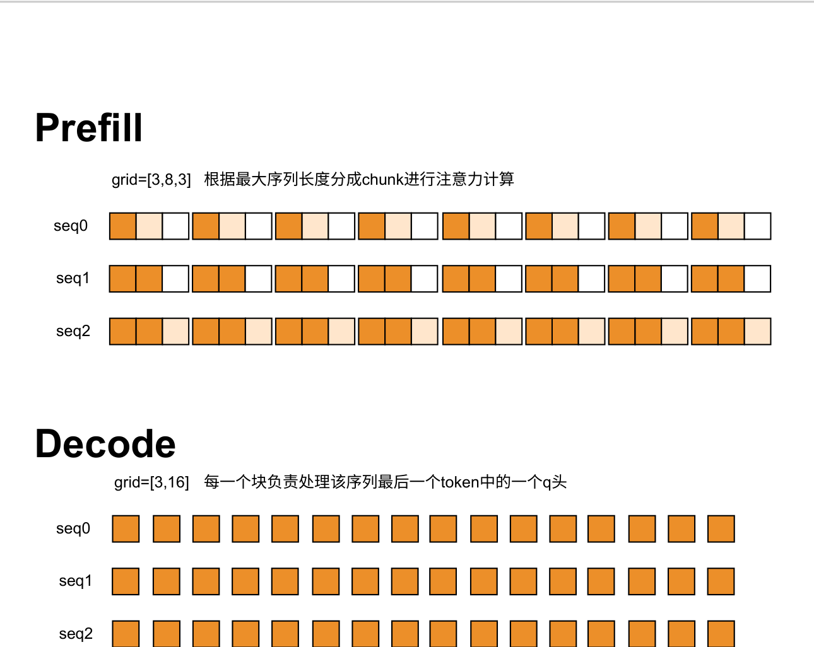
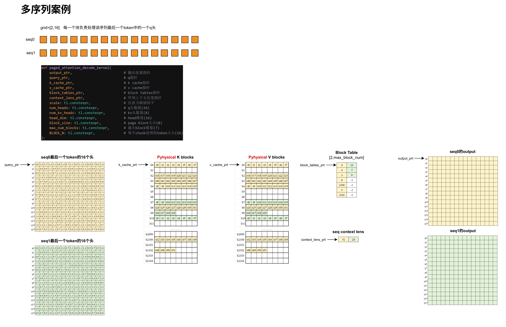
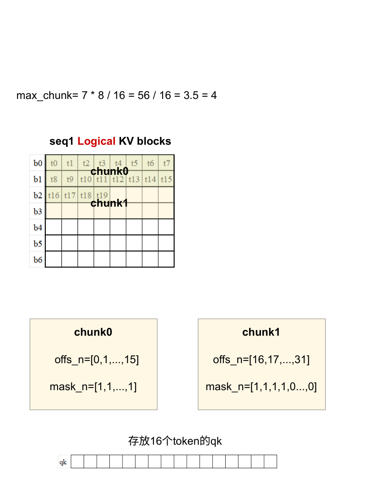

# 第 9 章 Decode：PagedAttention 与性能验证

decode 阶段每条序列每次只输入一个新 token，却要读取它此前所有层的 K/V。第 7 章已把当前 token 写入缓存；本章要解决的问题是：如何从一个物理上不连续的块表中取向量，并在不重建稠密 K/V 的情况下完成精确注意力。最后再用官方 A6000 数据检验“向量化分块读取”究竟改善了什么。

必须先澄清术语：**FlashAttention 是计算分块与 online softmax，PagedAttention 是 KV 的块式存储与间接寻址，两者正交。** 本章的 decode kernel 同时使用二者。它不是把注意力退化为逐 token 的标量 softmax，也不是把 paged cache 先复制成连续大张量再计算。

## 源码定位与调用契约



*图 9.1　Prefill 需要按 Q 块、头和序列展开三维网格，Decode 则主要按序列与 Query 头展开二维网格。橙色块的排列直观解释了两种内核 launch 的并行粒度差异。（原课程课件）*


| 位置 | 内容 |
|---|---|
| `src/myvllm/layers/attention.py:283-394` | 生产路径的 `paged_attention_decode_kernel` |
| `src/myvllm/layers/attention.py:397-452` | `BLOCK_N`、网格与启动包装器 |
| `src/myvllm/layers/attention.py:472-518` | 当前 K/V 先写 cache，再进入 decode |
| `src/myvllm/engine/model_runner.py:317-343` | `context_lens`、块表 padding 与新槽位 |
| `benchmark_decoding.py:25-263` | 逐 token 标量版与分块向量版 Triton 对照 |
| `benchmark_decoding.py:270-446` | 两种 PyTorch 实现、乱序块表与 FP32 参考 |
| `benchmark_decoding.py:449-542` | 先校验后计时、CUDA Event 与命令行扫描 |

decode 输入为 `query:(B,H,D)`、两个 `(num_blocks,block_size,Hkv,D)` cache、`block_tables:(B,max_num_blocks)` 和 `context_lens:(B,)`。正常生成时 `context_len>=1`，且包含当前 query 对应的 token；因为写入先于注意力，当前 token 能与全部历史一起参与计算。单个最新 query 对 $0\ldots L-1$ 全部可见，所以不再需要 prefill 那种上三角 causal mask。

## 网格映射：一个序列、一个 query 头

包装器在 `head_dim<=128` 时选择 `BLOCK_N=64`，否则选择 32，网格为：

```python
grid = (batch_size, num_heads)
kv_head_idx = head_idx // (num_heads // num_kv_heads)
q_offset = batch_idx * num_heads * head_dim + head_idx * head_dim + offs_d
```

`tl.program_id(0)` 对应序列，`tl.program_id(1)` 对应 query 头。每个 program 载入一条 Q 向量，并维护 FP32 的向量 `acc[head_dim]`、标量 `l_i` 和标量 `m_i`。GQA 下多个 query 头共享一个 KV 头，不需要复制 K/V。

program 按 `BLOCK_N` 个逻辑 token 为一块顺序遍历上下文，最大迭代数由块表容量决定：

```python
max_chunks = tl.cdiv(max_num_blocks * block_size, BLOCK_N)
for chunk_idx in range(max_chunks):
    token_start = chunk_idx * BLOCK_N
    if token_start < context_len:
        # 处理一个 KV chunk
```

`max_num_blocks` 是批内 padded 块表宽度，不一定等于当前序列实际块数。短序列通过 `token_start<context_len` 跳过无效工作；块表短于一行的部分由 ModelRunner 填 `-1`。

## 任意 block_size 的逐 token gather

一个计算 chunk 可能跨多个存储块。设当前 lane 的全局逻辑 token 下标为 $t$，存储块大小为 $B_s$，则：

$$
\ell=\left\lfloor t/B_s\right\rfloor,\qquad s=t\bmod B_s,\qquad p=block\_tables[b,\ell]
$$

K/V 元素偏移仍为：

$$
\operatorname{off}_{KV}=pB_sH_{kv}D+sH_{kv}D+h_{kv}D+d
$$

关键是**每个 token lane 都执行一次块表 gather**，而不是每个 chunk 只取一个物理块。当前生产实现的核心为：

```python
offs_n = token_start + tl.arange(0, BLOCK_N)
logical_block = offs_n // block_size
offs_in_block = offs_n % block_size
in_range = ((offs_n < context_len)
            & (logical_block < max_num_blocks))
physical_block = tl.load(
    block_tables_ptr + batch_idx * max_num_blocks + logical_block,
    mask=in_range, other=-1)
valid = in_range & (physical_block != -1)
physical_block = tl.where(valid, physical_block, 0).to(tl.int64)
kv_offset = (physical_block[None, :] * (block_size * num_kv_heads * head_dim)
             + offs_in_block[None, :] * (num_kv_heads * head_dim)
             + kv_head_idx * head_dim + offs_d[:, None])
k = tl.load(k_cache_ptr + kv_offset, mask=valid[None, :], other=0.0)
v = tl.load(v_cache_ptr + kv_offset, mask=valid[None, :], other=0.0)
```

这种映射不假设 `block_size` 是 2 的幂，也不假设它能被 `BLOCK_N` 整除。例如 `block_size=16、BLOCK_N=64` 时，一个 chunk 跨 4 个逻辑块；若只 gather 首 token 的块号，后 3 块都会被错误映射。K、V 共用一次 `kv_offset`，避免重复计算地址和重复查询块表。

注意第二项只能是 `offs_in_block`，不能是全局 `offs_n`。物理块基址已经跳过 `p*B_s`，再加全局下标会二次计入此前逻辑块，轻则读取其他序列的数据，重则越过 cache 末尾。

## mask 为什么还要配合地址钳制



*图 9.2　这张图适合先建立 decode 内核的整体数据契约：query、K/V cache、block_tables 和 context_lens 如何共同定位历史 token，以及每个序列和 Query 头如何对应输出位置。（原课程课件）*


`tl.load(..., mask=valid)` 会抑制无效 lane 的实际读取，**不会抑制 `kv_offset` 的地址算术**。若保留 `physical_block=-1`，即使随后 load 被 mask，仍可能先生成负偏移或发生整数溢出。

源码因此先执行：

```python
physical_block = tl.where(valid, physical_block, 0).to(tl.int64)
```

这把所有无效 lane 的地址钳到物理块 0 的合法区域，再由 K/V load 的 `valid` mask 禁止真正读取。随后 `qk=tl.where(valid,score,-1e10)` 和 `weight=tl.where(valid,p,0.0)` 又保证块 0 的数值绝不进入结果。地址安全与数值屏蔽是两道不同防线。

`in_range` 同时检查逻辑 token 和逻辑块号，防止读取 padded 块表之外。有效物理块号必须落在 cache 的 `num_blocks` 内，这依赖 BlockManager 的分配契约；`!=-1` 并不能验证任意损坏的正数块号。

## int64 防溢出发生在指针加法之前

块表在 `benchmark_decoding.py` 和 ModelRunner 中使用 `torch.int32`，但**索引存储类型不必等于地址运算类型**。官方技术路线给出的例子是 `block_size=256、Hkv=8、D=128`，每块 K 或 V 含：

$$
256\times8\times128=262144\text{ elements}
$$

物理块号 8192 与该项相乘恰好达到 $2^{31}$，已经超出有符号 int32 的最大值。若乘法先在 int32 中完成，之后再把结果加到 64 位指针上也无法挽回。`.to(tl.int64)` 必须放在大块跨度乘法之前，提升整个相关表达式的精度。

这里的数值单位是元素，不是字节；换成 fp16 后实际字节跨度还会继续翻倍。编写新 kernel 时，也应同样审计大 batch、总 token 数等其它偏移，而不能只依赖 Python 主机侧整数不会溢出的经验。

## Decode 也是分块 online softmax

一个 decode chunk 的 K 形状为 `(D,BLOCK_N)`，通过沿头维归约得到每个 token 一个分数：

```python
k = tl.cast(k, tl.float32)
score = tl.sum(q[:, None] * k, axis=0) * scale
qk = tl.where(valid, score, -1e10)
m_new = tl.maximum(m_i, tl.max(qk))
alpha = tl.exp(m_i - m_new)
p = tl.exp(qk - m_new)
v = tl.cast(v, tl.float32)
weight = tl.where(valid, p, 0.0)
acc = acc * alpha + tl.sum(weight[None, :] * v, axis=1)
l_i = l_i * alpha + tl.sum(weight)
m_i = m_new
```

对所有已处理 token，状态满足：

$$
a=\sum_t e^{s_t-m}V_t,\qquad \ell=\sum_t e^{s_t-m},\qquad output=a/\ell
$$

新块到来时，$\alpha=e^{m_{old}-m_{new}}$ 同时重标定旧分子和旧分母。因此数学结果等于对完整逻辑上下文做一次稳定 softmax，但任何时刻都不需要保存长度为整个上下文的概率数组；有限精度下仍会归约次序不同而产生小误差。这正体现了正交关系：块表回答“去哪读”，online softmax 回答“读完怎样合并”。

正常 decode 至少有一个有效 token，最终 `l_i>0`。若把 kernel 单独用于 `context_len=0`，需要另行定义空上下文输出，不能直接沿用 `acc/l_i`。

## 四种实现究竟在比较什么



*图 9.3　Decode 按 chunk 遍历逻辑 token：chunk0 覆盖 0 至 15，chunk1 从 16 开始，有效长度 mask 会屏蔽最后一个不完整 chunk 的越界位置，随后才进行 online softmax。物理块定位可对照同章的多序列总图。（原课程课件）*


| 实现 | K/V 准备与计算方式 | 主要问题或目的 |
|---|---|---|
| Naive PyTorch | Python 按块 gather，拼成稠密 K/V，再做注意力 | 直观基线，含主机循环与稠密副本 |
| Fast PyTorch | 按序列向量化逐 token gather，仍拼稠密 K/V | 减少循环，但保留 padding、分配和 GQA 复制 |
| Triton per-token | 每个 chunk 内用标量循环依次处理 K，再依次处理 V | 正确但 SIMD 利用不足的对照 |
| Triton chunked | 每 lane 独立 gather，一次向量 load K、一次 load V | 当前生产路线，任意块大小且保持 online softmax |

“Fast PyTorch”并不天然最快：它仍构造 `(batch,max_context,Hkv,head_dim)` 的 K/V 副本，并可能执行 `repeat_interleave`。PagedAttention 的价值恰在于直接消费分块缓存，而不是先恢复一个稠密 padded 批次。

`setup_test_data` 使用 `torch.randperm` 打乱物理块号。若使用恒等块表，忽略块表、错用全局 token 作块内偏移等错误都可能被掩盖，所以乱序映射是性能数字可信的前提之一。

## 官方 A6000 性能结果

以下数字**逐项引自 MinivLLM 官方 `HowToApproachvLLM_zh.md` 的“性能测试结果”表**，条件为 Qwen3-0.6B 注意力形状 `H=16、Hkv=8、D=128、block_size=256`、fp16、单张 A6000。单位为单次调用毫秒，括号内为相对 Naive PyTorch 的加速比。**本章编写过程中未在本地复测，这些数字不代表其它 GPU、软件版本或端到端模型吞吐。**

| batch | seq_len | Naive PyTorch | Fast PyTorch | Triton per-token | Triton chunked |
|---:|---:|---:|---:|---:|---:|
| 1 | 128 | 0.385 (1.0x) | 0.778 (0.5x) | 0.088 (4.4x) | **0.028 (14.0x)** |
| 1 | 512 | 0.445 (1.0x) | 0.977 (0.5x) | 0.340 (1.3x) | **0.026 (16.8x)** |
| 1 | 2048 | 0.735 (1.0x) | 0.818 (0.9x) | 1.939 (0.4x) | **0.098 (7.5x)** |
| 8 | 128 | 0.833 (1.0x) | 3.780 (0.2x) | 0.084 (10.0x) | **0.026 (31.8x)** |
| 8 | 512 | 1.232 (1.0x) | 4.029 (0.3x) | 0.465 (2.7x) | **0.040 (31.1x)** |
| 8 | 2048 | 4.297 (1.0x) | 5.042 (0.9x) | 1.848 (2.3x) | **0.127 (33.9x)** |
| 32 | 128 | 2.272 (1.0x) | 14.410 (0.2x) | 0.127 (17.9x) | **0.034 (67.5x)** |
| 32 | 512 | 4.574 (1.0x) | 15.147 (0.3x) | 0.518 (8.8x) | **0.130 (35.1x)** |
| 32 | 2048 | 16.849 (1.0x) | 19.681 (0.9x) | 1.975 (8.5x) | **0.493 (34.2x)** |

结果支持三个谨慎观察：分块向量版整体优于标量逐 token 版；稠密 gather 的成本会随 batch 和 padded 上下文放大；batch 1 只有 16 个 `(sequence,head)` program，是并行度短板。官方路线提出后续可把 KV 序列拆给多个 program，即 flash-decoding，再用第二个 kernel 合并各 split 的 `(m,l,acc)`；这属于后续优化，不是当前源码已经实现的功能。

官方同一节还给出 `batch=4、seq_len=1000` 的块大小对照，来源与未本地复测声明同上：

| block_size | Triton per-token | Triton chunked | 官方所列加速比 |
|---:|---:|---:|---:|
| 16 | 0.978 ms | 0.056 ms | 17.5x |
| 32 | 0.979 ms | 0.056 ms | 17.5x |
| 100 | 1.014 ms | 0.057 ms | 17.8x |
| 256 | 0.955 ms | 0.053 ms | 18.0x |

`block_size=100` 特意既不是 2 的幂，也不是 `BLOCK_N=64` 的整数倍。该表是所列配置的结果，不代替对其它长度、padded 块表和边界条件的正确性测试。

## 正确性先于计时

`benchmark_decoding.py` 的 `reference_output` 按每个逻辑 token 独立查表，将 K/V 转为 FP32，再逐序列、逐头计算参考注意力。各实现先计算 `max_err`，默认以 `tol=2e-2` 判定，然后才进入 `time_ms`；默认预热 10 次、计时 100 次，并使用 CUDA Event。

这个顺序不能颠倒。读错内存的 kernel 可能因少读了数据而显得很快，但 `correct=NO` 时耗时没有意义。若发生非法访存，脚本会停止，因为 CUDA context 可能已被破坏，不能继续把后续输出当作可靠测量。

复测命令为：

```bash
uv run python benchmark_decoding.py
uv run python benchmark_decoding.py --batch-sizes 4 --seq-lens 1000 --block-size 100
```

应记录完整命令、GPU、驱动、CUDA、PyTorch、Triton、功耗/时钟状态及误差，不只摘录最快一行。脚本的单次 attention 调用耗时也不等于 `main.py` 的每 token 延迟；后者还包含各层、采样、调度与通信。`ModelRunner` 在未启用 `enforce_eager` 时还会捕获 decode CUDA Graph 以减少启动开销，但本章 benchmark 并没有因此自动变成端到端图重放测试。

## 实践

1. 令 `block_size=16、BLOCK_N=64`，在纸上列出一个 chunk 内 64 个 lane 的 `logical_block` 与 `offs_in_block`，解释为什么每 chunk 一次查表必然错误。
2. 构造长度 `block_size-1、block_size、block_size+1` 以及 `63、64、65` 的序列，使用乱序物理块表与 `-1` padding，对照 `reference_output`。
3. 暂时移除地址钳制或 int64 转换，先用静态地址推导说明风险，再恢复源码；不要为了复现非法访存而在重要进程或设备上运行危险 kernel。
4. 用 Python 验证 `8192*256*8*128 == 2**31`，区分“块表可以用 int32 存储”和“地址乘法必须提升为 int64”。
5. 若要实现 split-KV，先为每个 split 保存 `(m,l,acc)`，再推导跨 split 合并公式；只有结果重新通过参考测试后，才比较性能。

## 小结

当前 decode 是“paged 逐 token gather + 分块 online softmax”：网格负责序列和 query 头，块表负责逻辑到物理寻址，$(m,l,acc)$ 负责跨 chunk 的精确归一化。任意 `block_size` 要求每 lane 独立查表；mask 必须配合地址钳制；大跨度乘法必须提前提升为 int64。官方单张 A6000 结果支持分块向量化的价值，但本章未本地复测，且微基准不能替代正确性检查和端到端测量。

## 参考资料

- MinivLLM 仓库：`src/myvllm/layers/attention.py`、`src/myvllm/engine/model_runner.py`、`benchmark_decoding.py`。
- [MinivLLM 官方技术路线：PagedAttention、常见错误与 A6000 性能表](https://github.com/Wenyueh/MinivLLM/blob/main/HowToApproachvLLM_zh.md)。
- Kwon 等，[Efficient Memory Management for Large Language Model Serving with PagedAttention](https://arxiv.org/abs/2309.06180)。
- Dao 等，[FlashAttention: Fast and Memory-Efficient Exact Attention with IO-Awareness](https://arxiv.org/abs/2205.14135)。
- [Triton `tl.load` 文档：mask 与 other](https://triton-lang.org/main/python-api/generated/triton.language.load.html)。
