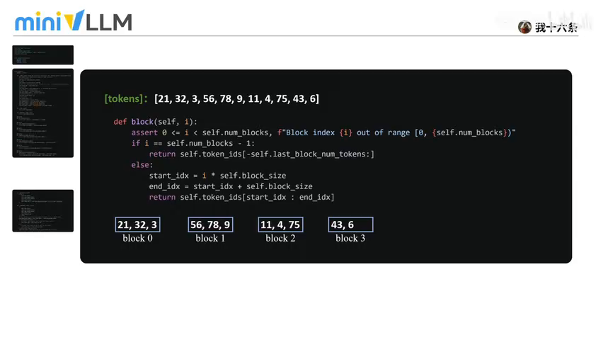
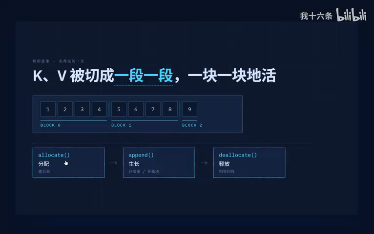
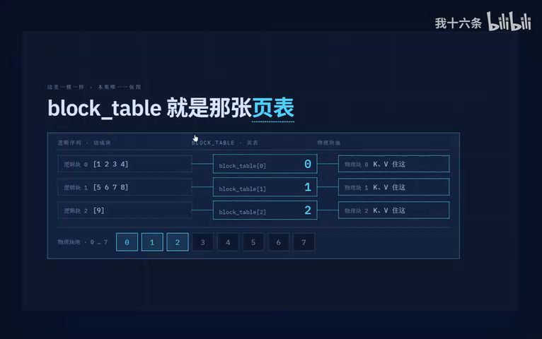

# 第 11 章 Sequence、Block 与 BlockManager


*图 11.1　从逻辑 token 到物理 KV 地址的完整链条：t // B 定位逻辑块，t % B 定位块内 slot，block_table 把逻辑块号翻译成物理块号。逻辑序列保持连续，但物理块无需连续或按序排列。（SVG 示意图）*

PagedAttention 的内核负责读写非连续 KV Cache，而“哪个逻辑 token 放在哪个物理块”由引擎侧对象决定。MinivLLM 用 `Sequence` 保存请求及其 token 账本，用 `Block` 描述固定容量的物理槽位，再由 `BlockManager` 维护块表、引用计数和哈希。本章以当前源码梳理三者的不变量，并特别说明为什么代码中的 `hash_to_block_id` 不能被直接等同于已经可用的跨序列前缀缓存。

## 源码定位与对象关系



*图 11.2　Sequence 把 token 账本按固定块长暴露给引擎：完整块通过起止索引切片，末块则用 last_block_num_tokens 处理不足一块的情况。示例中的 11 个 token 因此得到 3 个完整块和 1 个含 2 个 token 的末块。（原课程视频帧，00:04:05）*


| 文件 | 关键位置 | 阅读重点 |
|---|---|---|
| `src/myvllm/engine/sequence.py` | 第 8—114 行 | 状态、token 计数、逻辑分块与执行序列化 |
| `src/myvllm/engine/block_manager.py` | `Block`，第 7—26 行 | 物理块元数据及引用初始化 |
| 同上 | `BlockManager`，第 28—160 行 | 分配、追加、释放与哈希匹配 |
| `src/myvllm/engine/model_runner.py` | 第 265—343 行 | 块表、`slot_mapping` 与模型输入的连接 |
| `src/myvllm/engine/scheduler.py` | 第 35—118 行 | 分配和释放的调用时机 |

一条 `Sequence` 的 `block_table` 是按逻辑顺序排列的物理 `block_id` 列表。例如块表 `[7, 2, 9]` 表示逻辑第 0 块在物理块 7，第 1 块在物理块 2，第 2 块在物理块 9；逻辑相邻并不要求物理地址相邻。每层的 K/V Cache 使用相同块编号空间，实际缓存张量形状为 `[num_blocks, block_size, num_kv_heads, head_dim]`。

从对象职责看，`Sequence` 不知道 GPU 张量，`Block` 也不知道完整请求；二者通过 `BlockManager` 建立映射。`ModelRunner` 再把映射转换为内核可读取的 `block_tables` 和 `slot_mapping`。

## Sequence：请求的 token 账本

### 初始化字段

`SequenceStatus` 只有 `WAITING`、`RUNNING`、`FINISHED` 三种状态。抢占没有独立枚举值，被抢占序列会回到 `WAITING`。新序列总是以 `WAITING` 开始，`seq_id` 来自类级 `itertools.count()`，因此在同一 Python 进程中单调分配。

| 字段 | 当前语义 |
|---|---|
| `token_ids` | Prompt 与已生成 token 的完整列表；构造时浅复制输入列表 |
| `num_tokens` | 当前 token 总数，与列表长度同步 |
| `num_prompt_tokens` | 初始 Prompt 长度，生成过程中不变 |
| `last_token` | 当前最后一个 token；空列表时为 `None` |
| `num_cached_tokens` | 分配时声明可以复用的前缀 token 数，正常完整重算路径为 0 |
| `block_table` | 逻辑块到物理块 ID 的有序映射 |
| `temperature` 等 | 从 `SamplingParams` 提取的采样与停止参数 |

派生计数遵循两个基本等式：

```text
num_completion_tokens = num_tokens - num_prompt_tokens
num_blocks            = ceil(num_tokens / block_size)
```

`prompt_token_ids` 与 `completion_token_ids` 都用 `num_prompt_tokens` 切分原列表，因此生成新 token 不会改写 Prompt 的边界。`append_token` 同时追加列表、更新 `last_token` 并增加 `num_tokens`，但它本身不分配物理块；物理资源由调度器在模型执行前准备。

### 逻辑分块与末块长度

设 `block_size=4`，一条序列已有 10 个 token，则：

```python
seq = Sequence(list(range(10)), block_size=4)
# num_blocks == 3
# last_block_num_tokens == 2
# block(0) == [0, 1, 2, 3]
# block(1) == [4, 5, 6, 7]
# block(2) == [8, 9]
```

非末块通过 `[i * block_size : (i + 1) * block_size]` 切片；末块通过 `token_ids[-last_block_num_tokens:]` 取得。长度恰好是块大小整数倍时，`last_block_num_tokens` 等于 `block_size`，而不是 0。`block(i)` 的断言要求 `0 <= i < num_blocks`，所以空序列或越界下标不能按普通切片语义理解。

`num_cached_blocks` 使用 `ceil(num_cached_tokens / block_size)`。当前分配逻辑只给完整块增加缓存 token 数，因此正常命中情形下该值对应完整前缀块数；它不是已分配物理块总数。

## Block：物理槽位的元数据

一个 `Block` 只有四项元数据：

- `block_id`：在 KV Cache 池中的固定物理编号；
- `hash`：完整块内容及其前缀的哈希，部分块使用 `-1`；
- `ref_count`：当前引用该块的序列数；
- `token_ids`：用于哈希碰撞复核的逻辑 token 内容。

新构造的块引用计数为 0、哈希为 -1、内容为空。`_allocate_block` 要求引用计数必须为 0，然后调用 `reset()`。当前 `reset()` 将 `ref_count` 设为 **1**，不是 0，因为从空闲链表取出块的操作本身就是在为一个序列建立首个引用。随后它从 `free_block_ids` 删除 ID，并加入 `used_block_ids`。

空闲与使用中集合的含义应保持如下关系：空闲块引用为 0，可以重新分配；使用中块至少有一个引用。`free_block_ids` 是 `deque`，新释放块追加到右端，常规新分配从左端取首个 ID；`used_block_ids` 是无序集合，只用于成员判断和生命周期管理，不承担序列块顺序。

## allocate：从逻辑块到块表



*图 11.3　BlockManager 围绕固定大小的 KV 块组织请求生命周期：分配逻辑块，随着新 token 到来追加或扩展，序列结束时释放。顶部例子同时说明末块可以未填满。（原课程视频帧，00:01:30）*


### 完整块的链式哈希

`compute_hash` 使用 xxhash64。若存在前序哈希，先把前序值按小端 8 字节写入，再写入以 `int32` 表示的 token 内容。第 `i` 个完整块可抽象为：

```text
h[-1] = -1
h[i]  = xxh64(encode(h[i-1]) || int32_bytes(block_token_ids[i]))
```

因此相同内容出现在不同前缀之后，通常不会被视为同一块。部分块不计算内容哈希，`h` 被置为 -1。分配循环的关键结构是：

```python
token_ids = seq.block(i)
h = self.compute_hash(token_ids, h) if len(token_ids) == self.block_size else -1
block_id = self.hash_to_block_id.get(h, -1)
if block_id == -1 or self.blocks[block_id].token_ids != token_ids:
    # 未命中：分配新块并记录哈希
else:
    # 命中：增加缓存计数和引用计数
seq.block_table.append(block.block_id)
```

字典命中后仍比较 `token_ids`，这是哈希碰撞复核：相同 64 位哈希并不被当作内容相等的充分条件。未命中时，新块经 `update(h, token_ids)` 保存内容，完整块的哈希再写入 `hash_to_block_id`。

`can_allocate(seq)` 只检查 `len(free_block_ids) >= seq.num_blocks`。它按整条序列所需块数做保守判断，并不先扣除潜在命中块。`allocate` 则逐块把 ID 追加到 `seq.block_table`，调用方应提供块表为空的序列；已结束或被抢占序列会先经过 `deallocate` 清空旧映射。

## 前缀缓存：数据结构存在，不代表功能已经启用

这是阅读当前实现时最容易误判的地方。`hash_to_block_id`、链式哈希、命中分支和 `num_cached_tokens` 确实构成了前缀缓存的外观，但**当前版本不能把跨序列 Prefix Caching 当作已经真正启用且可正确消费的能力**。

### 释放时主动使旧内容失效

当前 `_deallocate_block` 的核心操作是：

```python
assert self.blocks[block_id].ref_count == 0
block = self.blocks[block_id]
block.token_ids = []
self.used_block_ids.remove(block_id)
self.free_block_ids.append(block_id)
```

也就是说，当最后一个引用消失，物理块回到空闲队列之前，其 `token_ids` 会被清空。旧的哈希键和 `block.hash` 可以暂时残留，但下一次 `allocate` 即使通过旧哈希找到这个块，也会因 `[] != token_ids` 而判定未命中。由此，**已结束或已释放序列的块不会通过当前匹配逻辑为后续序列提供前缀复用**。

清空的是 `Block.token_ids`，不是原 `Sequence.token_ids`。请求的文本与生成历史仍然保留，变化的是“物理块仍可被缓存命中”的证据。块以后重新分配时，`reset()` 还会重置哈希、引用计数和内容。

### 尚未释放的命中分支也不是完整功能

如果原块仍在 `used_block_ids` 中，`allocate` 的命中分支会增加 `ref_count`，并给新序列增加 `num_cached_tokens`。但不能据此宣称跨序列前缀缓存已经支持：该分支只是不完整实现的一部分，当前 Prefill 路径无法正确消费被跳过的前缀。

一个无需伪造内部字段的场景是：令 `block_size=4`，同一批提交两条长度为 6 的相同 Prompt。序列 A 先完成分配和 prefill 且仍在 running，其首个完整块保留在 `used_block_ids` 中；序列 B 随后分配时，首块哈希和内容都能匹配，于是 B 的 `num_cached_tokens` 增加 4，A 的对应块引用数增加。B 的第二个部分块仍需新分配，但 `prepare_prefill` 只会输入最后两个 token。

`ModelRunner.prepare_prefill` 从 `token_ids[num_cached_tokens:]` 构造输入，并令 query 长度短于完整 K 长度；然而 `layers/attention.py` 的 Prefill FlashAttention 只使用本轮计算的 Q/K/V 和 `cu_seqlens_q`，没有通过 `block_tables` 读取历史 KV，也没有使用 `cu_seqlens_k` 组织历史范围。同时，Qwen3 与 Llama 的 Decoder 为每条 Prefill query 从位置 0 重新生成 RoPE 位置，缺少缓存长度偏移。上述 B 因而只看得到本轮两个 token 的 K/V，并以错误位置计算它们，而不是获得 A 已缓存的四 token 前缀。

所以统一结论是：**已释放块禁止命中，活跃块命中路径也不正确，因此功能不可用。** 未发生哈希命中的完整 Prefill 才符合当前内核的自包含假设；活跃重复 Prompt 会自动进入上述错误路径，不能把“完整重算”描述为所有请求都能获得的可靠兜底。真正启用复用至少需要能从分页缓存读取历史 K/V 的 Prefill 内核、区分 query/key 长度，以及从 `num_cached_tokens` 开始的位置编码，并补充释放与共享生命周期测试。

## append：Decode 前的容量与边界维护

调度器在 Decode 前先调用 `can_append` 和 `append`，此时 `seq.last_token` 是上一轮采样得到、即将作为本轮输入的 token。`BlockManager` 要保证它的 KV 有物理槽位；本轮采样结果则由 `postprocess` 中的 `seq.append_token` 稍后加入账本。

`can_append` 与新块分配分支必须采用同一边界条件。下面的模 1 / 模 0 讨论以 `block_size>1` 为前提，`block_size=1` 的确定缺陷单独列在后面：

```python
if seq.num_tokens % self.block_size == 1:
    return len(self.free_block_ids) > 0
return True
```

当当前长度模块大小为 1 时，最后 token 是一个新逻辑块的第一个 token，需要一块空闲物理块；模块大小为 0 时，最后 token 恰好填满旧块，不需要新块；其他情况仍落在旧的部分块内。

| 当前 `num_tokens mod block_size` | `append` 行为 |
|---|---|
| `0` | 用刚完成的完整块内容及前一块哈希更新哈希和 token 内容 |
| `1` | 断言前一块已有哈希，从空闲队列分配新块并追加块表 |
| 其他 | 不分配；断言末块正在使用且仍是 `hash == -1` 的部分块 |

完整块哈希在 `append` 中同样链接前一块的 `hash`。若新块分支出现，前一块必须已经完整并具备哈希，这一断言维护了“非末块都是完整块”的不变量。

以 `block_size=4` 为例，Prompt 长度为 4，第一次采样后账本长度变为 5。此时新增的第 5 个 token 尚无物理块；下一次 Decode 调度看到 `5 % 4 == 1`，才为它分配第二个块。之后长度 6、7 都在该部分块内，长度 8 时完成哈希，而不分配第三个块。

### `block_size=1`：模 1 / 模 0 算法失效

上述分支判别要求 **`block_size>1`**。当 `block_size=1` 时，任意 `num_tokens % 1` 都等于 0：`can_append` 的新块条件永远为假，因此即使没有空闲块也返回 `True`；`append` 则永远进入“模 0、更新完整块哈希”的分支，永远不会进入“模 1、分配新块”的分支。

例如 Prompt 有 2 个 token，初始块表为 `[p0,p1]`。采样追加第 3 个 token 后，Decode 前的 `append` 不会追加 `p2`，反而用 `seq.block(2)` 的第 3 个 token 更新旧块 `p1` 的元数据，块表仍只有两项。随后 `prepare_decode` 把第 3 个 token 的 K/V 写入 `p1`，而 `context_lens=3` 却只有两个块表项，既覆盖旧槽位又缺少新逻辑块映射。这是确定性缺陷，不是容量不足时的偶发风险。修复前不能把这种配置当作受支持的边界情况；可以明确拒绝 `block_size=1`，也可以为新块判定和哈希更新分别设计正确分支。

回归测试应构造上述长度 2 → 3 的过程，至少断言：Decode 前需要新块时 `can_append` 不能无条件为真，`append` 后块表长度应由 2 变为 3，新 token 使用独立物理槽位，旧块内容不被改写；再经 `prepare_decode` 核对 `slot_mapping` 和块表覆盖完整上下文。修复前，该测试应稳定暴露“块表不增长”，而不是被写成预期通过。

## deallocate：引用计数与序列状态分离



*图 11.4　逻辑块顺序与物理块位置通过 block_table 解耦。序列看到的是连续的逻辑 token 块，而 KV 实际写入由表项指定的物理块；新增块时只需追加一个映射项。（原课程视频帧，00:03:30）*


`deallocate(seq)` 遍历序列块表，将每个块的 `ref_count` 减 1；只有减到 0 才调用 `_deallocate_block`。若未来共享块真正可用，其余引用仍能阻止物理块提前释放。遍历结束后还会执行：

```python
seq.block_table = []
seq.num_cached_tokens = 0
```

所以释放同时断开序列到物理块的映射，但不删除请求 token，也不直接修改 `Sequence.status`。结束状态由 `Scheduler.postprocess` 设置，回到等待队列则由 `Scheduler.preempt` 设置。块管理和请求状态机相互关联，却不是同一个对象的职责。

## 执行序列化不是完整对象快照

`Sequence.__getstate__` 只打包 `num_tokens`、`num_prompt_tokens`、`num_cached_tokens`、`block_table` 和最后一个字段：尚无生成 token 时传完整 `token_ids`，已有生成 token 时只传 `last_token`。`__setstate__` 在后者情况下把 `token_ids` 恢复为仅含最后 token 的列表。

这套格式面向模型执行输入的传递，而不是请求归档：它没有恢复 `seq_id`、状态、采样参数等全部构造字段，主进程中的原始 `Sequence` 仍负责保存完整生成历史。阅读多进程代码时，不应把 worker 收到的对象当作主进程序列的完整克隆。

尤其要注意，`__setstate__` 也没有恢复 `block_size`。正常 prefill 会访问 `num_cached_blocks`，正常 decode 会经由 `last_block_num_tokens` 访问 `num_blocks`，这些属性都依赖缺失字段，所以 worker 的正常数据准备会确定性抛出 `AttributeError`。这是静态可证的多进程阻断，不只是对象归档信息不完整。

## 实践检查

1. 用 `block_size=4` 分别构造长度 0、1、4、5、8、9 的逻辑例子，手算 `num_blocks` 与 `last_block_num_tokens`；特别注意 0 和整数倍边界，再对照 `sequence.py` 的公式。
2. 对长度 10 的序列写出三个逻辑块及预期块表长度，交换物理 ID 为 `[9,1,6]`，说明为什么模型仍能按逻辑顺序读取 KV。
3. 沿一次 `_allocate_block` 检查四个动作：`reset`、从空闲队列删除、加入使用集合、返回块。确认首个引用计数为 1，并解释若误设为 0 会对释放产生什么影响。
4. 给一条序列分配后调用 `deallocate`，逐项检查：每个引用减 1、零引用块的 `token_ids == []`、ID 回到空闲队列、序列块表为空、`num_cached_tokens == 0`，而 `Sequence.token_ids` 保留。
5. 构造“字典里仍有旧哈希、对应块已经释放”的情形，沿 `allocate` 的比较条件说明为什么旧键不会命中。不要把“哈希未删除”误写成“旧 KV 一定复用”。
6. 用 `block_size=4` 和两条长度为 6 的相同 Prompt 构造活跃命中：前一序列完成 prefill 后保持 running，再分配后一序列。追踪非零 `num_cached_tokens`、被跳过的输入、FlashAttention 缺失的历史 KV 来源和 RoPE 偏移，验证活跃命中路径为什么不正确；再与前一序列已释放、块内容被清空后的禁止命中情形对照。
7. 在 `block_size=4` 下依次模拟当前长度 4、5、7、8、9 的 Decode 前检查，标出何处需要空闲块、何处只更新哈希、何处什么都不做，并核对 `can_append` 与 `append` 是否完全一致。
8. 以 `block_size=1` 构造 Prompt 长度 2、采样后长度 3 的序列，断言当前 `append` 后块表仍不增长，并继续核对 `prepare_decode` 的旧槽位覆盖和块表缺失；修复后再把“分配独立新块”转为预期通过的回归断言。
9. 对正常 prefill 和 decode 的 `Sequence` 分别做 pickle 往返，并调用 worker 数据准备所需的属性。当前应确定性复现缺失 `block_size` 的 `AttributeError`，修复后再验证完整准备流程。

## 小结

`Sequence` 维护完整 token 历史和逻辑块视图，`Block` 维护物理块内容、哈希与引用，`BlockManager` 则把二者连接到 KV Cache 池。分配时完整块使用链式哈希并复核 token，Decode 前按模块大小处理新块与完整块，释放时减少引用并清空序列块表。当前 `_deallocate_block` 明确清空 `Block.token_ids`，所以已释放块禁止命中；活跃块虽可能命中，但缺少分页 Prefill 历史读取和 RoPE 位置偏移，会跳过 token 后错误计算，因此功能整体不可用。`block_size=1` 的追加算法和跨进程反序列化缺失 `block_size` 也都是确定性缺陷，不能混入一般待验证项。

## 参考资料

- [MinivLLM 源码仓库](https://github.com/Wenyueh/MinivLLM)：本章以 `sequence.py`、`block_manager.py`、`model_runner.py` 和 `attention.py` 当前实现为依据。
- [vLLM：Prefix Caching](https://docs.vllm.ai/en/latest/features/automatic_prefix_caching.html)：理解成熟实现中前缀复用的目标；不能用其能力描述替代 MinivLLM 当前行为。
- [xxhash Python 绑定](https://github.com/ifduyue/python-xxhash)：核对 `xxh64` 哈希接口。
- [NumPy 字节与数据类型文档](https://numpy.org/doc/stable/reference/arrays.dtypes.html)：理解 token 转为 `int32` 后参与哈希的字节表示。
