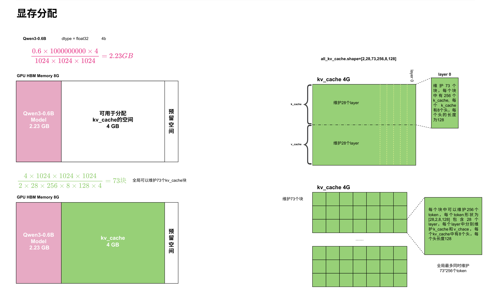

# 第 13 章 ModelRunner：数据准备、KV 显存与 CUDA Graph

`ModelRunner` 位于调度器与模型之间。它把 `Sequence` 列表转换成模型所需的张量和注意力上下文，估计并分配 KV cache，还实现了解码阶段的 CUDA Graph 捕获与重放。理解这一层，关键是区分主机侧的元数据、设备侧的计算缓冲区，以及只在 rank 0 上执行的采样。

## 源码定位与调用关系



*图 13.1　这组课件示例把显存估算与张量布局连在一起：先确定可用于 KV Cache 的空间，再除以单个块的字节数得到块数。右侧逐级展开 K、V、28 层、256 个槽位、8 个头和头维 128，适合配合 ModelRunner 的分配代码阅读。（原课程课件）*


本章主要阅读以下文件：

- `src/myvllm/engine/model_runner.py`：初始化、数据准备、显存估计、模型执行和图捕获；
- `src/myvllm/utils/context.py`：以进程内全局 `Context` 保存当前批次的注意力元数据；
- `src/myvllm/layers/attention.py`：写入 KV cache，并分别调用 prefill 与 decode 内核；
- `src/myvllm/layers/sampler.py`：按温度执行随机采样；
- `src/myvllm/models/qwen3.py` 与 `llama.py`：读取上下文、构造位置并计算 logits。

一次正常执行可以概括为：

```text
prepare_prefill / prepare_decode
        ↓ set_context
run_model：直接执行模型，或重放 decode CUDA Graph
        ↓
compute_logits → rank 0 准备温度并采样
        ↓
reset_context → 返回 token_ids；非 0 rank 返回 None
```

`Context` 不是跨进程共享对象。每个 rank 都根据收到的序列数据建立自己的上下文，并独立执行模型。

## prefill：拼接变长序列

`prepare_prefill` 不把所有提示补成等长二维矩阵，而是把各序列尚未计算的 token 拼接成一维 `input_ids`。对序列 `i`，代码分别记录：

- 查询长度：`len(token_ids) - num_cached_tokens`；
- 键值长度：`len(token_ids)`；
- 前缀和：`cu_seqlens_q` 与 `cu_seqlens_k`，首元素均为 0；
- 写入位置：`slot_mapping`，把逻辑 token 映射到物理 KV block 内的槽位；
- 读取索引：必要时将各序列的 `block_table` 用 `-1` 补齐到相同列数。

例如，`block_size=4`，某序列总长度为 6，已有 4 个缓存 token，物理块表为 `[7, 2]`。本次只计算两个 token，元数据为：

```text
cu_seqlens_q = [0, 2]
cu_seqlens_k = [0, 6]
slot_mapping = [8, 9]       # 物理块 2 的前两个槽位
block_tables = [[7, 2]]
```

`slot_mapping` 只遍历 `num_cached_blocks` 之后的新块；完整块加入整个块的槽位，最后一块只加入 `last_block_num_tokens` 个槽位。这解释了为什么缓存写入不需要连续的逻辑 KV 缓冲区。

这个例子只用于核对索引，不能当作可用的端到端前缀复用。当前 `BlockManager._deallocate_block` 清空已释放块的 `token_ids`，所以**已释放块禁止命中**；但活跃块仍可能命中，例如同一批两条相同 Prompt 中，前一序列完成 prefill 后仍存活，后一序列便可能复用其完整块并跳过 token。该活跃命中路径也不正确：prefill 注意力不利用 `block_tables` 读取旧 KV，RoPE 又缺少 `num_cached_tokens` 偏移，会产生错误计算，因此功能整体不可用。上述元数据示例恰好能说明这种风险，而不是证明复用已经闭环。

## pinned memory 与 non_blocking

三种准备函数都采用同一种主机到设备传输方式：

```python
def to_cuda(values, dtype):
    return torch.tensor(
        values, dtype=dtype, pin_memory=True
    ).cuda(non_blocking=True)
```

`pin_memory=True` 让主机张量位于页锁定内存，适合异步主机到设备复制；`non_blocking=True` 允许复制与主机后续执行重叠。后者本身不会把普通可分页内存变成页锁定内存，也不表示设备计算已经完成。

这里每一步都会创建新的 pinned tensor。写法简洁，但分配页锁定内存也有成本，不能预设它一定优于普通复制。若性能分析显示主机准备占比较高，可以进一步实验可复用缓冲区；修改前后都应检查结果，并在计时末尾同步 CUDA。

另外，模型中的 `cu_seqlens_q.cpu().tolist()`、`LLMEngine.step` 中的 `outputs.cpu().tolist()` 都会引入主机可见的数据依赖。局部使用异步复制，不代表整个流水线没有同步点。

## decode：每条序列只输入一个 token

解码准备函数为每条序列收集：

1. `last_token`，形成长度为批大小的一维 `input_ids`；
2. `len(seq)` 作为 `context_lens`，其当前位置为 `context_lens - 1`；
3. 最后一个物理块中的写入槽位；
4. 用 `-1` 补成矩形的 `block_tables`。

调度器上一轮把采样 token 追加到 `Sequence` 后，该 token 成为下一轮的输入；本轮再计算它的 K/V，并采样下一个 token。因而 decode 的 `slot_mapping` 指向当前最后一个 token，而不是预先指向未来 token。

`prepare_sample` 则按当前 `seqs` 的顺序生成 `float32` 温度向量。顺序必须与 logits 的行顺序一致，否则不同序列会误用温度。

## sample：只保留必要计算

`run` 先执行所有 rank 共有的模型计算，再只在 `rank == 0` 时调用采样器：

```python
if self.rank == 0:
    token_ids = self.sampler(logits, self.prepare_sample(seqs))
```

当前 `SamplerLayer` 将 logits 除以温度，计算 softmax，再通过指数随机变量实现随机采样。`SamplingParams` 拒绝接近零的温度，因此这里没有 greedy 开关。非 0 rank 的返回值为 `None`，其局部计算结果由张量并行通信和 rank 0 的后续调度衔接。

## warmup：用真实路径测量峰值

初始化先保存默认 dtype，再执行 `warmup_model()`：

```text
清空未使用的缓存块 → 重置峰值统计
→ 构造 max_num_batch_tokens // max_model_length 条满长序列
→ 执行一次 prefill → 再次 empty_cache
```

warmup 的目的不是生成文本，而是触发模型执行、临时缓冲区分配以及可能的编译，为 KV 池估计提供峰值数据。构造的批大小必须大于 0；若配置使整除结果为 0，后续 `max(seqlens_q)` 等操作无法正常进行。

`torch.cuda.empty_cache()` 只释放 caching allocator 中未使用的缓存段，不会删除仍被模型参数或 KV cache 引用的张量，也不等于降低当前实际占用。

## KV cache：由显存估计反推块数

`allocate_kv_cache` 先读取空闲显存和 warmup 的峰值，再按下式估计预算：

```text
available = free_mem × gpu_memory_utilization
            - (peak_allocated - current_allocated)
```

单个 block 同时保存所有层的 K 和 V。每 rank 的字节数为：

```python
block_bytes = (
    block_size * 2 * num_layers
    * (num_kv_heads // world_size)
    * head_dim * dtype.itemsize
)
```

例如，块大小为 4、层数为 2、每 rank 有 2 个 KV head、`head_dim=64`、元素为 2 字节时，一个块只占 4096 字节。实际模型应把完整参数代入，并注意默认 dtype，而不能只按序列条数估算。

可分配块数为 `available // block_bytes`，至少要有 1 块。多卡时，各 rank 用 `all_reduce(MIN)` 取最小值，避免 rank 0 的调度器按照较大的本地容量向较紧张的其他 rank 分配块。随后配置中的 `max_cached_blocks` 会被这个结果覆盖；示例配置里的初始值并不是此处分配的上限。

最终分配形状为：

```text
[2, num_layers, max_cached_blocks, block_size,
 local_num_kv_heads, head_dim]
```

索引 0 和 1 分别对应 K、V。代码把每层的视图绑定到注意力模块的 `k_cache`、`v_cache`，整个池只分配一次。使用 `zeros` 还会付出初始化成本，但能避免未初始化内容干扰调试。

## CUDA Graph：固定地址，重放 decode

当 `enforce_eager=False` 时，初始化会调用 `capture_cudagraph`。它为最大批次预分配 `input_ids`、`slot_mapping`、`context_lens`、`block_tables` 和 `outputs`，捕获 `[1, 2, 4, 8] + range(16, max_bs + 1, 16)` 中的批大小，并共享图内存池。

捕获前会先直接执行一次模型，随后在 `torch.cuda.graph` 中再次执行。每个图记录的是模型主体的 CUDA 工作；重放后，`compute_logits` 和采样仍在图外执行。当前 `outputs` 实际承载的是模型隐藏状态，不是最终 logits。

真实批次大小为 `bs` 时，选择逻辑的注释声称要找“能容纳 `bs` 的最小图”，表达式是 `next(bs_ for bs_ in self.graphs.keys() if bs_ >= bs)`。但捕获循环使用 `reversed(batch_sizes)`，所以 `self.graphs` 按容量**降序插入**；Python 字典又保持插入顺序，`next` 实际返回首个满足条件的最大图，而不是最小图。例如键顺序为 `[16,8,4,2,1]` 时，`bs=1` 和 `bs=3` 都会选择 16。这是确定性的选图设计缺陷，会增加不必要的计算，并放大 padding 状态风险。

### padding、stale 状态与当前实现的核查边界

固定图要求固定地址和静态形状，但当前重放只显式处理部分无效区域：`context_lens` 会整体清零，`slot_mapping` 只对 `[:bs]` 填充 `-1` 并覆盖，`input_ids` 的其余行和 `block_tables` 的其余区域没有统一清理。尤其当小批次借用大图时，padding 行仍参与被捕获的模型主体；尾部 `slot_mapping` 若保留上次非负值，重放的 KV 写入就可能访问旧槽位。最后只取 `outputs[:bs]` 并不能撤销这些写入。变批、变块表宽度实验必须覆盖这些 stale 状态，不能假定 padding 已全部自动复位。

除上述选图缺陷外，还有三项源码事实需要在实验前记录：

- 捕获读取 `config['max_num_seqs']`，而示例和调度器使用 `max_num_sequences`，直接关闭 eager 会遇到配置键不一致；
- 图输出缓冲区按 `[max_bs, vocab_size]` 创建，但模型主体返回 `[bs, hidden_size]` 的隐藏状态，两者需要按实际形状修正；
- 实际批大小超过最大捕获容量时没有 eager 回退，`next(...)` 找不到合适图。

因此，本章描述的是图捕获结构与审查方法，不宣称当前示例的图路径已经通过端到端验证。`main.py` 和 `main_llama32.py` 均设置了 `enforce_eager=True`。

## 两种“共享内存”不要混淆

`ModelRunner` 还使用 `multiprocessing.shared_memory.SharedMemory`。多 rank 时，rank 0 创建名为 `myvllm`、大小为 `2**20` 字节的主机共享内存，前 4 字节保存 pickle 数据长度，其余区域保存方法名和参数；`Event` 负责通知 worker。它是进程间控制通道，不保存 KV cache，详细时序见第 14 章。

GPU 教程中的 shared memory 则指内核使用的片上资源。`benchmark_prefilling.py` 的 Naive Triton 版本用 `BLOCK_SIZE² × 4` 字节估算注意力矩阵资源，并限制序列长度；Flash Attention 分块执行在线 softmax，避免完整 `N²` 矩阵。实际寄存器、片上内存占用和可行块大小仍应以 Triton 编译结果与目标 GPU 为准。

## 实践验证

先在不构造完整模型的情况下检查 prefill 元数据。以下实验需要项目依赖和可用 CUDA 环境，只验证准备函数，不验证前缀缓存注意力：

```python
runner = ModelRunner.__new__(ModelRunner)
runner.block_size = 4
seq = Sequence([10, 11, 12, 13, 20, 21], block_size=4)
seq.num_cached_tokens = 4
seq.block_table = [7, 2]
ids = runner.prepare_prefill([seq])
ctx = get_context()
assert ids.cpu().tolist() == [20, 21]
assert ctx.slot_mapping.cpu().tolist() == [8, 9]
assert ctx.cu_seqlens_q.cpu().tolist() == [0, 2]
assert ctx.cu_seqlens_k.cpu().tolist() == [0, 6]
reset_context()
```

随后按以下顺序扩大验证范围：

1. 用不等长序列检查一维拼接、累计长度和 `-1` 块表 padding；
2. 用非连续物理块号检查 decode 的读取与写入槽位，避免恒等块表掩盖寻址错误；
3. 记录 warmup 前后的当前显存、峰值显存和最终块数，手算一个 block 的字节数并交叉核对；
4. 在 eager 模式先建立正确性基线，再单独修正并测试图路径，覆盖批次 1、3、9、最大批次和超过最大批次；直接断言所选容量是大于等于 `bs` 的最小捕获值，并用不同的历史 `slot_mapping` 连续变批，检查大图 padding 行不会写入旧槽位；
5. 多 rank 时确认所有进程打印的全局 `max_cached_blocks` 一致，并检查异常退出后共享内存和进程是否残留。

本章编写环境未安装 PyTorch，上述 CUDA 实践均未实际运行；可复现性结论应以读者记录的版本、硬件、命令和输出为准。

## 小结

`ModelRunner` 把调度结果转化为变长 prefill 或逐 token decode 所需的上下文，通过 pinned memory 发起设备复制，并在 warmup 后按显存预算建立分页 KV 池。CUDA Graph 依靠固定缓冲区和批大小 padding 重放模型主体，但当前降序字典使 `next` 选择最大可容图而非最小图，配置键、输出形状和 stale padding 也仍有明确缺陷。主机共享内存、GPU 片上共享内存与 KV cache 是三类不同资源，不能混为一谈。

## 参考资料

- 项目源码：`src/myvllm/engine/model_runner.py`、`src/myvllm/utils/context.py`。
- 项目源码：`src/myvllm/layers/attention.py`、`benchmark_prefilling.py`。
- [PyTorch：CUDA 语义与 pinned memory](https://docs.pytorch.org/docs/stable/notes/cuda.html)。
- [PyTorch：torch.cuda.CUDAGraph](https://docs.pytorch.org/docs/stable/generated/torch.cuda.CUDAGraph.html)。
- [Python：multiprocessing.shared_memory](https://docs.python.org/3/library/multiprocessing.shared_memory.html)。
