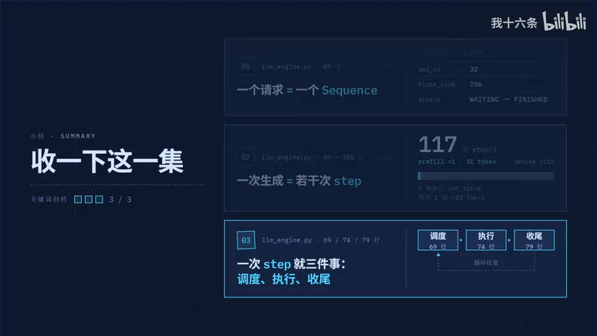

# 第 14 章 LLMEngine、多进程张量并行与生成 API

`LLMEngine` 把分词器、调度器和 `ModelRunner` 组合成同步生成接口。单卡时，主进程直接执行 rank 0；多卡时，它通过 `spawn` 创建 worker，用 NCCL 完成张量并行集合通信，并用主机共享内存广播每一步的方法与序列元数据。本章同时说明设计流程和当前源码的边界，避免把“进程已经创建”误认为“多卡生成已经验证”。

## 源码定位



*图 14.1　LLMEngine 的主循环可压缩为一条清晰主线：请求先封装为 Sequence，随后反复执行 step；每个 step 依次完成 Scheduler 调度、ModelRunner 执行和 postprocess 收尾。（原课程视频帧，00:05:50）*


- `src/myvllm/engine/llm_engine.py`：进程创建、调度循环、生成 API 和退出；
- `src/myvllm/engine/model_runner.py`：rank 初始化、共享内存协议、模型调用；
- `src/myvllm/engine/sequence.py`：序列状态与 pickle 序列化；
- `src/myvllm/layers/linear.py`：列并行、行并行与 `all_reduce`；
- `src/myvllm/layers/embedding_head.py`：词表分片、logits 汇聚；
- `main.py` 与 `main_llama32.py`：配置和同步调用示例。

引擎一层的调用关系如下：

```text
generate(prompts)
  → add_prompt：encode → Sequence → waiting
  → while not scheduler.is_finished()
      → step：schedule → ModelRunner.call("run")
      → sampled ids 转 CPU list → scheduler.postprocess
  → 按 seq_id 排序 → decode → 返回字典
```

## 初始化：先启动 worker，再进入 rank 0

构造函数读取 `world_size`，固定使用 `torch.multiprocessing.get_context("spawn")`。它依次为 `rank=1..world_size-1` 创建一个 `Event` 和子进程，子进程入口是：

```python
def worker_process(config, rank, event):
    model_runner = ModelRunner(config, rank, event)
    model_runner.loop()
```

子进程各自初始化完成后进入循环；主进程在启动这些子进程后也构造自己的 `ModelRunner(rank=0)`，并不等待 worker 完成全部模型初始化。各 rank 可以并发推进，随后在分布式初始化和显式屏障处会合。因此，多卡初始化不是父进程单方面完成的。

每个 rank 都执行：

```text
dist.init_process_group("nccl", "tcp://localhost:12345")
→ torch.cuda.set_device(rank)
→ 构造分片模型并加载权重
→ warmup → 分配 KV cache → 可选图捕获
```

NCCL 要求合适的 CUDA 环境；rank 同时被当作本机 GPU 编号。固定 rendezvous 地址意味着当前实现面向单节点，固定端口和共享内存名也不适合同一主机上的多个独立引擎实例。

由于使用 `spawn`，调用入口必须受 `if __name__ == "__main__":` 保护，项目两个 main 脚本均已如此处理。子进程会重新导入模块，不能把引擎创建无保护地写在模块顶层。

## worker 初始化屏障与共享内存建立

模型、KV cache 和可选图捕获完成后，多 rank 才进入共享内存建立阶段。屏障顺序是：

1. 所有 rank 执行第一个 `dist.barrier()`，确认此前的初始化均已完成；
2. rank 0 尝试关闭并 unlink 旧的 `myvllm`，然后创建 1 MiB 共享内存；
3. rank 0 在创建后执行第二个屏障，其他 rank 在 attach 前执行对应屏障；
4. 非 0 rank 打开同名共享内存，返回 `worker_process` 并进入 `loop()`。

这一顺序避免 worker 在 rank 0 尚未创建共享内存时抢先 attach。它不能修复此前的模型构造、图捕获或权重加载错误；任何一个 rank 在屏障前失败，其余 rank 仍可能等待。

rank 0 返回引擎构造函数后才创建分词器和 `Scheduler`。调度器因此能读取被各 rank `all_reduce(MIN)` 更新后的 `max_cached_blocks`，而不是仅依据 rank 0 的本地显存估计。

## 控制通道：长度前缀、pickle 与 Event

rank 0 的 `call` 在本地执行方法前，先向共享内存写入 `(method_name, *args)` 的 pickle 数据：

```text
共享内存 [0:4]   = 数据长度 n，小端整数
共享内存 [4:n+4] = pickle 字节
随后对每个 worker Event 调用 set()
```

worker 的 `read_shm` 等待事件，读取长度和内容，再清除事件。`loop` 通过 `getattr` 调用同名方法。rank 0 与其他 rank 因而执行相同的 `run`，并在模型内部的 NCCL 集合通信处协调。

代码注释提到“写回结果”，但当前协议没有 worker 向 rank 0 返回通用 RPC 结果的数据通道。模型所需的跨 rank 数值通过 NCCL 传输，worker 的 `run` 返回值则为 `None`，并未通过共享内存回传。

共享内存只有 `2**20` 字节，写入前没有显式容量检查；pickle 也只适用于这些受信任的自有进程。固定单槽消息和事件适合讲解控制流，不是带排队、确认、超时和故障恢复的通用 RPC 框架。

## Sequence 如何跨进程传递

`Sequence.__getstate__` 用元组减少 pickle 内容：保存 token 计数、提示长度、缓存计数、块表，并根据是否有生成 token 选择完整 `token_ids` 或仅 `last_token`。

正常首轮 prefill 尚无 completion，因此发送完整提示；正常 decode 只发送最新 token，同时保留计数和块表，设计上让 worker 据此重建本步所需元数据。rank 0 的采样结果不需要立即广播，因为下一轮调度会再次序列化更新后的序列。

当前精简序列化存在**静态可证的阻断**：`__setstate__` 没有恢复 `block_size`，而 `num_cached_blocks`、`num_blocks`、`last_block_num_tokens` 等属性会访问它。worker 收到正常调度序列后，prefill 在非空块表的写入循环中访问 `seq.num_cached_blocks`，decode 在计算写入槽位时访问 `seq.last_block_num_tokens`；两者都会因缺少该属性确定性地抛出 `AttributeError`，使正常 prefill/decode 数据准备无法完成。这不是一般的“待验证风险”，需先修复序列化字段恢复，再谈多卡执行。被抢占后重新 prefill 的序列是否保留了完整 token 历史，则是另一个仍需多进程测试的问题。

## 张量并行：计算分片，rank 0 汇聚采样

层内张量并行主要有三条路径：

- `QKVColumnParallelLinear` 与 `MergedColumnParallelLinear` 按输出维分片，各 rank 计算本地 head 或本地 MLP 部分；
- `RowParallelLinear` 按输入维分片，并通过 `dist.all_reduce(SUM)` 合并部分结果；
- `VocabParallelEmbedding` 按词表分片，对不属于本 rank 的 token 掩码，再执行求和归并。

`ParallelLMHead` 同样按词表分片。多卡时，它使用 `dist.gather(..., dst=0)` 把局部 logits 汇到 rank 0，rank 0 拼接后裁掉词表 padding，得到完整词表上的 logits。随后只有 rank 0 调用 `SamplerLayer`，其他 rank 不采样。

因此，“rank 0 采样”不是随意指定主进程，而是与完整 logits 的汇聚位置一致。所有 rank 仍必须以相同顺序参加集合通信；一个 rank 跳过模型或改变调用次序，都可能导致等待或结果错误。

这些层展示了 TP 的基本结构，但端到端多卡正确性还取决于权重是否按分片加载、序列元数据是否完整以及所有 rank 是否同步退出，不能仅凭类名判断已经可用。

Llama 路径另有一个独立的**确定性多卡阻断**：`LlamaAttn` 虽然用本地头数 reshape Q/K/V，却以未分片的 `num_qo_heads`、`num_kv_heads` 构造 `Attention`。下游内核与输出展平因此仍按全局头数解释本地张量，形状和寻址契约不一致。即使先修复 loader 和 worker 序列化，这个问题仍会阻断 `TP>1`，不能归为一般待验证项。

## step：调度、执行与后处理

每次 `step` 先从调度器取得 `(scheduled_sequences, is_prefill)`。空批次直接返回；非空批次通过 `model_runner.call("run", ...)` 执行。

rank 0 得到 CUDA tensor 后调用 `outputs.cpu().tolist()`，这是主机与设备之间的同步数据依赖。`scheduler.postprocess` 逐序列追加 token，并检查三个停止条件：

1. 未设置 `ignore_eos` 且 token 等于 EOS；
2. completion token 数达到 `max_tokens`；
3. 总长度达到非空的 `max_model_length`。

结束的序列会被移出 running 并释放块。`step` 返回本次完成序列的 `(seq_id, completion_token_ids)`、处理 token 数和阶段标志。`generate` 根据返回值打印逐步吞吐：prefill token 数使用完整 `len(seq)`，decode 则按序列条数计数，适合观察运行过程，不应直接当作严格性能报告。

## generate 的真实返回类型是 dict

当前函数签名为：

```python
def generate(self, prompts: list[str],
             sampling_params: SamplingParams) -> list[str]:
```

但函数体最后构造并返回的是：

```python
output = {
    "text": [self.tokenizer.decode(tokens) for tokens in generated_tokens],
    "token_ids": generated_tokens,
}
return output
```

所以**当前源码的类型注解与实际行为不一致，调用者必须以函数体中的 dict 为准**。`main.py`、`main_llama32.py` 和 `benchmark_tps.py` 都已按字典访问：

```python
outputs = llm.generate(prompts, sampling_params)
assert isinstance(outputs, dict)
texts = outputs["text"]
completion_ids = outputs["token_ids"]
```

`text` 是 completion 的解码结果，不包含原提示；`token_ids` 同样只包含生成部分。结果按 `seq_id` 排序，在一个引擎实例中，这些 id 单调分配，因而对本次提交通常保持 `prompts` 的输入顺序。不要写成 `outputs[0]`，也不要把它当作 vLLM 的 `RequestOutput` 列表。

`generate` 是同步批量接口：所有序列结束后才返回，没有逐 token 流式输出。它也没有把第一次返回 token 的时间单独暴露出来，因此无法仅凭现有返回值计算严格的 TTFT。

## 退出与资源清理

设计上，rank 0 的 `LLMEngine.exit()` 通过 `call("exit")` 通知 worker，然后删除本地 runner 并 `join()` 所有子进程。`ModelRunner.exit()` 负责关闭共享内存，rank 0 额外 unlink；非 eager 时删除图对象，最后同步 CUDA 并销毁 process group。构造函数还用 `atexit.register(self.exit)` 注册解释器退出清理。

当前实现不是幂等清理：worker 的 `loop` 通过 `self.call("exit")` 已动态调用一次 `exit`，随后又在 `method_name == "exit"` 分支调用一次；引擎若被手工 `exit` 后，`atexit` 仍可能再次访问已删除的 runner。多卡退出实验应明确检查这些路径，而不只观察主进程是否返回。

此外，`join()` 没有超时，worker 初始化失败或集合通信异常时没有统一的取消协议。生产服务还需要超时、异常传播、强制回收和幂等状态机，当前项目不具备这些完整保证。

## 实践验证

先运行单卡 eager 示例，确认生成 API 的字典结构：

```bash
uv run python main.py
uv run python main_llama32.py
```

上述命令会加载真实模型并占用较多显存，应根据本地 checkpoint 与 GPU 条件执行，不要把 README 中的模型描述当作输出质量承诺。本章编写时未运行这两个示例。

多卡实验至少按以下层级推进：

1. 先独立验证列并行、行并行和词表分片，使用单卡参考实现比较数值；另查 `LlamaAttn` 传入 `Attention` 的头数，TP 大于 1 时必须是本地值而非全局值；
2. 先修复并回归 `Sequence` 反序列化缺失 `block_size` 的确定阻断，再验证 pickle 往返后的块表、token 历史和温度需求是否满足本步执行；
3. 用两张可见 GPU 检查 NCCL rendezvous、两个初始化屏障和各 rank 的 KV 块数最小值；
4. 对比 rank 0 的完整 logits、采样 token 与下一轮 worker 收到的 `last_token`；
5. 分别测试正常结束、worker 初始化异常、生成中异常和显式退出，检查进程、端口与 `myvllm` 是否残留；
6. 最后才进行多卡性能测量，并固定采样随机性、模型、输入和输出长度。

静态检查 API 契约不需要导入 CUDA 依赖，可用 AST 找到 `generate` 的注解和最后的字典赋值。它只能证明源码结构，不能替代实际生成测试。本章的多进程与多 GPU 实践均标记为未运行。

## 小结

`LLMEngine` 用同步循环串联分词、调度、执行和后处理。多 rank 初始化依靠 NCCL 屏障会合，控制消息依靠共享内存和 Event 广播，TP 计算依靠集合通信，完整 logits 汇聚后仅由 rank 0 采样。当前 `generate` 实际返回含 `text` 与 `token_ids` 的字典，而非注解所写的 `list[str]`。worker 反序列化缺失 `block_size` 和 LlamaAttn 向 `Attention` 传全局头数都是静态可证的多卡阻断；修复这些确定问题后，异常处理和幂等退出仍需专门验证。

## 参考资料

- 项目源码：`src/myvllm/engine/llm_engine.py`、`model_runner.py`、`sequence.py`。
- 项目源码：`src/myvllm/layers/linear.py`、`embedding_head.py`、`sampler.py`。
- [PyTorch：分布式通信](https://docs.pytorch.org/docs/stable/distributed.html)。
- [PyTorch：多进程与 spawn](https://docs.pytorch.org/docs/stable/multiprocessing.html)。
- [Python：共享内存](https://docs.python.org/3/library/multiprocessing.shared_memory.html)。
- [Python：atexit](https://docs.python.org/3/library/atexit.html)。
